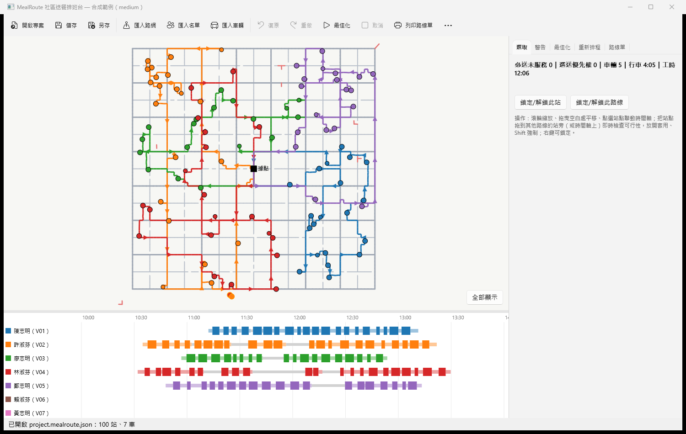
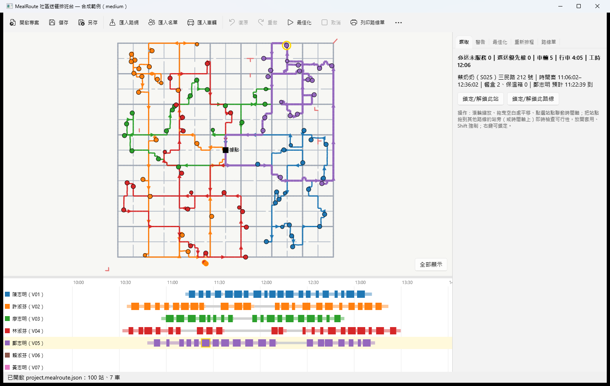
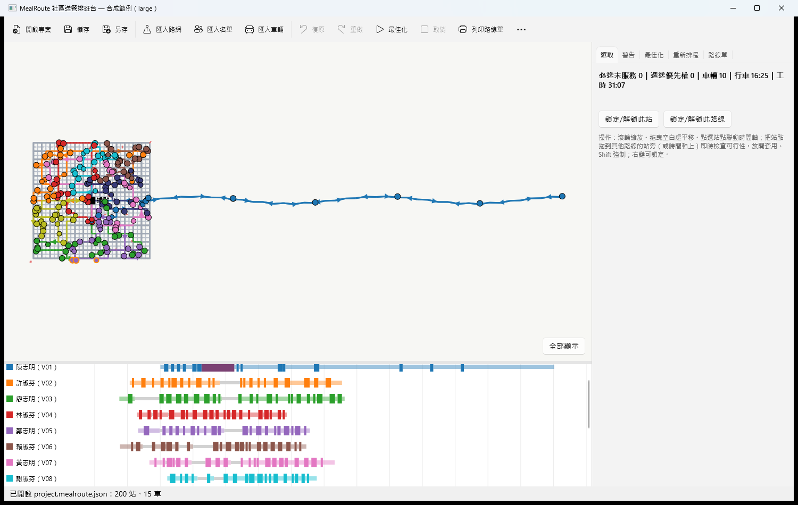
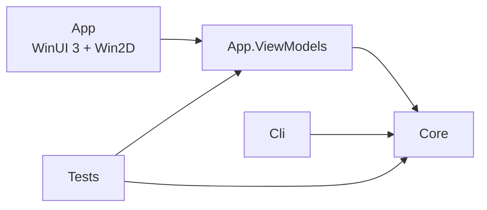

# MealRoute 社區送餐排班台

[](https://github.com/hn83320589/MealRoute/actions/workflows/ci.yml)

社區關懷據點每天中午與傍晚為 150–250 位獨居長者送餐。MealRoute 是一個 Windows 桌面工具：匯入街道圖（GeoJSON）與當天名單後，自動排出每台車的路線與時間；可以拖曳調整、鎖定站點，當天有車延誤或故障時重新安排；最後列印每位駕駛的路線單。



- 設計文件：[系統分析](docs/01-system-analysis.md)、[系統架構](docs/02-architecture.md)
- 範例與預期結果：[samples/](samples/README.md)
- Solomon 基準結果：[benchmarks/solomon/RESULTS.md](benchmarks/solomon/RESULTS.md)

---

## 目錄

1. [功能](#功能)
2. [建置與執行](#建置與執行)
3. [操作說明](#操作說明)
4. [架構](#架構)
5. [演算法](#演算法)
   - [路網、強連通分量與吸附](#路網強連通分量與吸附)
   - [速度模型與 FIFO](#速度模型與-fifo)
   - [時間相依最短路徑](#時間相依最短路徑)
   - [行車時間快取策略（L1 / L2）](#行車時間快取策略l1--l2)
   - [路線評估、出發時刻與休息](#路線評估出發時刻與休息)
   - [最佳化演算法（ALNS）](#最佳化演算法alns)
   - [增量評估與拖曳回饋](#增量評估與拖曳回饋)
   - [鎖定](#鎖定)
   - [當天重新排程](#當天重新排程)
6. [測試與參考實作](#測試與參考實作)
7. [效能與基準測試](#效能與基準測試)
8. [設計取捨與已知限制](#設計取捨與已知限制)

---

## 功能

| 類別 | 內容 |
|---|---|
| 路網匯入與檢查 | GeoJSON LineString（`id`、`oneway`、`class`）→ 有向圖；相同座標端點合併；強連通分量（SCC），小分量列警告並在地圖以紅色標示；無效幾何逐筆回報（feature 索引與 id） |
| 吸附 | 站點與據點吸附到**最大 SCC** 上最近路段的投影點，必要時分割路段並建立虛擬節點；雙向道路兩向可達、單行道只能順向；> 150 m 警告 |
| 行車時間 | 3 種道路等級 × 96 個 15 分鐘時段的速度表；時間相依最短路徑；站間行車時間快取（誤差可控、FIFO 保證） |
| 路線最佳化 | 多車、兩種容量（餐盒、保溫箱）、可用時段、最長工時、硬性時間窗、必送/選送（優先權 1–5）、駕駛休息規則；字典序目標；固定種子可重現；時間上限、隨時取消、進度回報 |
| 互動調整 | 在地圖或時間軸拖曳站點，即時（< 50 ms）顯示可行性、指標變化與第一個違反的條件；鎖定站點／路線；復原／重做 |
| 當天重新排程 | 回報「某車某時刻在某處、已完成哪些站、延誤幾分鐘」或「某車故障」，只重排尚未出發服務的站 |
| 地圖與時間軸 | Win2D 繪製：路網、站點、依車著色並有方向箭頭的路線、未服務站；縮放平移；每車一列甘特圖（行車、等待、服務、休息）；點選聯動 |
| 輸出 | 每位駕駛的路線單（可列印）；路線 CSV（UTF-8 with BOM）與 GeoJSON，皆可再匯入 |
| 專案與基準 | 專案檔（JSON）；合成城市與名單產生器；Solomon VRPTW 基準（靜態模式）與最佳已知解比較 |

---

## 建置與執行

需求：Windows 10 1809 以上（x64）、[.NET 9 SDK](https://dotnet.microsoft.com/download/dotnet/9.0)。不需要 Visual Studio；App 以 **unpackaged** 方式部署（Windows App SDK 自含）。

```powershell
git clone https://github.com/hn83320589/MealRoute.git
cd MealRoute

dotnet build MealRoute.sln -c Release -p:Platform=x64
dotnet test tests/MealRoute.Tests -c Release --filter "Category!=Benchmark"

# 發佈並執行桌面 App（可直接帶入專案檔路徑）
dotnet publish src/MealRoute.App -c Release -r win-x64 -p:Platform=x64 -o publish/win-x64
publish/win-x64/MealRoute.App.exe samples/medium/project.mealroute.json
```

CI 每次 push 在 `windows-latest` 建置、測試並把 win-x64 發佈檔上傳為 artifact（`MealRoute-win-x64`），可直接從 Actions 頁面下載執行。

命令列工具（產生範例、求解、基準）：

```powershell
dotnet run --project tools/MealRoute.Cli -c Release -- generate --size large --out samples/large
dotnet run --project tools/MealRoute.Cli -c Release -- solve --project samples/large/project.mealroute.json --seconds 60
dotnet run --project tools/MealRoute.Cli -c Release -- solomon --seconds 180 --out benchmarks/solomon/RESULTS.md
```

檔案位置：專案檔預設 `%UserProfile%\Documents\MealRoute\`，設定 `%LocalAppData%\MealRoute\settings.json`，未預期的 UI 例外記錄在 `%LocalAppData%\MealRoute\crash.log`。

---

## 操作說明

1. **開啟專案**（或「匯入路網」→「匯入名單」→「匯入車輛」）。路網小分量、吸附過遠的站會列在右側「警告」頁籤，並在地圖上以紅線／橘框標示。
2. **最佳化**：右側「最佳化」頁籤設定時間上限、獨立搜尋次數與種子，按「開始最佳化」。進度條單調遞增，隨時可「取消」，取消後採用目前最佳的**完整可行解**。
3. **檢視與調整**：滾輪縮放、拖曳空白處平移。點選站點時，時間軸上的對應服務條、車輛列同時高亮，右側顯示站名、時間窗、預計到達時刻（點選時間軸亦同）。
4. **拖曳**：把站點拖到其他路線的某站旁（或拖曳時間軸上的服務條到另一列／時間位置），會即時顯示「可行」或第一個違反的條件，例如「王奶奶 12:10 到，時間窗 11:30–12:00」，以及車輛數、行車、工時的變化。放開即套用（不可行的移動需按住 Shift 強制），可復原。
5. **鎖定**：右鍵站點 →「鎖定此站」或「鎖定整條路線」。重新最佳化時，鎖定站維持原車原位置，鎖定路線完全不變。
6. **當天重新排程**：「重新排程」頁籤 →「準備」（回報時刻預設為現在）→ 選車、勾選已完成站（依計畫預先勾選）、在地圖點選目前位置（未點選則以最後完成站為位置）、輸入延誤或勾選「故障」→「加入此車回報」（可多台）→「重新排程」→ 檢視前後比較 →「套用」（可復原）。
7. **輸出**：「路線單」頁籤可列印（每位駕駛一頁）或匯出 CSV／GeoJSON。

| 點選聯動（地圖 ⇄ 時間軸 ⇄ 選取資訊） | 大型範例：郊區長路線（藍）與休息（時間軸紫色段） |
|---|---|
|  |  |

---

## 架構

```
MealRoute.sln
├─ src/MealRoute.Core             net9.0：所有計算（無 UI、無 Windows 相依）
│   ├─ Geo / GeoJson / Network    haversine、GeoJSON 讀取、CSR 路網、Tarjan SCC、空間索引、吸附
│   ├─ Travel                     速度模型、TD Dijkstra/A*、L1/L2 行車時間 oracle、歐氏 oracle
│   ├─ Model / Evaluation         站點、車輛、解；路線評估（出發時刻、休息）、字典序目標、違反
│   ├─ Optimization               ALNS、多起點、鎖定、精確驗證
│   ├─ Editing / Rescheduling     增量編輯（拖曳預覽、復原）、當天重新排程
│   ├─ Planning                   TravelModel：匯入 → 吸附 → L1/L2 的組裝
│   ├─ Projects / Reports         專案檔、名單 CSV、路線單、路線 CSV/GeoJSON
│   └─ Benchmark / Synthetic      Solomon 讀取與 BKS、合成城市與名單
├─ src/MealRoute.App.ViewModels   net9.0：MVVM（CommunityToolkit.Mvvm），UI 服務以介面抽象
├─ src/MealRoute.App              WinUI 3 + Win2D：只有檢視、繪製與 UI 服務實作
├─ tools/MealRoute.Cli            產生器、求解、Solomon 基準
└─ tests/MealRoute.Tests          xUnit；Reference/ 為與正式程式碼互相獨立的參考實作
```



- **相依方向**：App → ViewModels → Core；Core 與 ViewModels 都是純 `net9.0`，可在任何平台測試。ViewModel 透過 `IFileDialogService`、`IUiDispatcher`、`IMessageService`、`IPrintService` 與 UI 溝通，測試時以假物件替換。
- **時間**：所有「現在時間」都經由注入的 `TimeProvider`；所有時刻皆為「當天 0 點起算的秒數」（`double`）。
- **選取聯動**：`SelectionService` 是唯一的選取狀態來源，地圖、時間軸、資訊面板都綁定它。
- **執行緒**：最佳化、重新排程、快取建立都在背景執行，進度經由 `IUiDispatcher` 回到 UI 執行緒。
- **不使用任何現成路徑規劃／VRP／最佳化套件**；GeoJSON 以 System.Text.Json 自行解析。套件僅 Windows App SDK、Win2D、CommunityToolkit.Mvvm 與測試用的 xUnit、TimeProvider.Testing（皆為 MIT／Apache 授權）。

---

## 演算法

### 路網、強連通分量與吸附

- **建圖**：只有 LineString 的兩端點成為節點，座標完全相同（位元相等，`-0.0` 視同 `0.0`）才合併；中間點只是幾何。邊長為 haversine（R = 6,371,008.8 m）逐點加總。`oneway` 為 `true`/`"yes"` 時沿座標方向，`"-1"` 時逆向，其他為雙向。採 CSR（compressed sparse row）儲存，邊依起點連續排列。
- **SCC**：迭代版 Tarjan（避免深遞迴；10 萬節點環狀圖測試），分量依最小節點編號正規化，最大分量同大小時取編號小者（決定性）。
- **吸附**：只考慮兩端都在最大 SCC 的路段（孤島與單行死巷不會被吸附）。以均勻格網空間索引找候選小段，投影依規格在「以該小段中點為原點的等距平面」計算。投影點與端點距離 < 1 m 時直接使用端點；同一路段上多個站點依位置排序後一次切開，相距 < 1 m 的切點合併，因此**不會產生零長度路段**。分割後各段長度用「沿線累計長度之差」計算，而不是重新以 haversine 量測，所以各段長度相加**恰好等於原長**。雙向道路的兩個有向邊共用同一個虛擬節點；單行道只切開順向那一條。

### 速度模型與 FIFO

每個道路等級有 96 個時段的速度（km/h，時段 k 涵蓋 [900k, 900(k+1)) 秒，一天之後循環）。通過長度 L 的路段時，從進入時刻起依當下時段的速度前進，遇到時段邊界就改用新時段的速度，直到走完 L：

```
remaining = L; t = 進入時刻
loop: k = ⌊t/900⌋; v = speed[k mod 96]
      reach = v·(900(k+1) − t)
      if reach ≥ remaining: return t + remaining/v
      remaining −= reach; t = 900(k+1)
```

**FIFO（晚出發不會早到）**：兩台車在同一路段上，任何時刻都以相同速度前進，晚進入的車距離終點永遠不會比早進入的車更近，所以不可能先到。路徑的到達時間函數是各路段函數的合成，單調不減函數的合成仍單調不減，因此**任意路徑都是 FIFO**。實作上以時段索引而非浮點比較決定速度，並處理浮點捨入落在邊界的情形，避免迴圈停滯。

### 時間相依最短路徑

在 FIFO 下，以「到達時刻」為標籤的 Dijkstra（label-setting）就是精確的最早到達演算法。實作採 CSR、以 (時刻, 節點) 破平手的優先佇列、以時間戳記重複使用的工作陣列（數千次查詢不需重新配置）。點對點查詢使用 **A\***，啟發函數為「直線 haversine 距離 ÷ 全速度表最高速度」，可容許（admissible）且一致。也支援多起點初始標籤（重新排程時車輛位於路段中間）與「目標全部定案就停止」。

### 行車時間快取策略（L1 / L2）

最佳化每秒需要數十萬次站間行車時間查詢，但規格要求「用於判定可行性的時間與以實際出發時刻精確計算相差 ≤ 1 秒、且不得違反 FIFO」。兩層設計：

| 層 | 做法 | 用途 |
|---|---|---|
| **L1** `PathSampledOracle` | 對每個地點（站點＋據點）在每個取樣時刻（預設每 15 分鐘，涵蓋車輛時段）跑 one-to-all TD Dijkstra，記錄到每個地點的最佳**路徑**。路徑壓縮為「同道路等級的連續段」（速度只看等級，合併後完全等價），每對地點只存不重複的路徑。查詢 t ∈ [tₖ, tₖ₊₁] 時，把兩端取樣點的路徑**以實際出發時刻精確積分**，取最小值 | 最佳化內迴圈、增量評估、拖曳的第一階段 |
| **L2** `ExactOracle` | 以實際出發時刻做點對點 TD A\*，依 (起, 迄, 出發時刻) 記憶（有上限） | 最終解的所有時刻與可行性判定、拖曳的確認階段、路線單與匯出 |

L1 的性質（皆有性質測試）：
1. 值永遠是**某條真實路徑**的精確時間 → 不小於精確最短時間（上界），在取樣時刻等於精確值。
2. **FIFO**：每條路徑的到達函數單調，取最小值仍單調；相鄰區間在共享的取樣點都等於精確值，所以接縫連續 → 全域 FIFO。
3. 取樣範圍外使用邊界取樣點的路徑（性質不變），不會退回慢速計算。
4. `Heal()` 可把 L2 找到的更佳路徑加入某區間的候選；只在決定性的時間點呼叫，以免平行搜尋的結果受執行緒時序影響。

**可行性永遠以 L2 為準**：最佳化結束（含取消）後，最佳解以 L2 重新評估；L1 是上界，所以 L1 判定可行的路線在 L2 下到達只會更早，只有休息規則（累計行車時間）可能翻轉，此時移除違反的站並嘗試以 L2 重新插入。因此路線單、匯出、拖曳確認的每個時刻都與精確計算一致（性質測試以獨立參考 TD Dijkstra 驗證 ≤ 1 秒）。

### 路線評估、出發時刻與休息

- **排程**：到達早於時間窗開始就等待；開始服務必須 ≤ 時間窗結束；服務後出發。容量是路線上需求總和（所有餐盒出發前裝載，無中途補貨）。工時 = 回到終點 − 出發（含等待、服務、休息）。
- **出發時刻是決策變數**：先以最早可出發時刻排程，再以**前向時間餘裕**（forward time slack）延後出發：可延後量 = min(全程等待總和, min over 各站(該站之前累計等待 + 時間窗結束 − 開始服務))。延後這麼多不會讓任何站遲到，回程時刻不變，而第一站之前與**路線中段**（例如午餐與晚餐時段之間）的等待都不再算進工時。FIFO 下晚出發不會早到，所以時間窗與最晚返回只受最早出發影響，延後只會縮短工時，因此工時上限的可行性判定也用這個出發時刻。時間相依時以定點迭代修正（殘餘可吸收等待 < 0.5 秒為止），任何讓排程不可行或工時變長的一步都不採用；所有試過的出發時刻中，先選符合工時上限的，再依目標順序選行車時間最少、工時最短的，所以不會為了縮短工時而延後進入尖峰、增加行車時間（除非工時上限需要）。固定出發的車（重新排程中的回報車）不延後。解中明確記錄出發時刻，參考檢查器只驗證它。
- **休息規則**：累計行車時間（不含等待與服務）超過 4.5 小時之前，必須在某站服務後休息 30 分鐘，休息後重新累計；等待不算休息。評估器只在「若不休息就會超過上限」的位置考慮休息，列舉該位置之前每個可休息的站（遞迴處理第二次休息），取「總行車時間最少、其次工時最短（計入該休息位置允許的出發延後）、再其次最早返回」的可行排程。因此不需要休息的路線不會被插入休息，而休息可以提前到某段等待之前，讓等待吸收休息時間。這個選擇與窮舉所有休息組合的結果一致（性質測試）。
- **違反**：不可行的路線會產生診斷排程（休息放在最晚可能位置、遇到違反仍繼續），回報**時間最早的違反**，例如「王奶奶 12:10 到，時間窗 11:30–12:00」、「保溫箱 9 個超過容量 8 個」、「工時 4:41 超過上限 4:30」。

目標依字典序比較（越小越好）：**未服務必送站數 → 未服務選送站優先權總和 → 使用車輛數 → 總行車時間 → 總工時**。行車時間以微秒格點比較，讓浮點雜訊不會蓋過真正的工時差異。

### 最佳化演算法（ALNS）

1. **建構解**：regret-2 平行插入，依層級（必送 → 選送優先權 5…1）挑選，確保必送站優先於一切。
2. **ALNS**（Ropke & Pisinger 式）：
   - destroy：隨機、最差（行車時間節省最多）、相關（Shaw：行車時間＋時間窗相近）、整條路線移除；規模 q ∈ [max(1, min(4, n/10)), min(60, 0.4n)]，站數 ≤ 12 時允許全部重建。
   - repair：greedy、帶雜訊的 greedy、regret-2、regret-3、隨機順序插入（SISR 式 blink：以 10% 機率略過某位置）；插入前以前一站在「最早出發」排程下的出發時刻做時間窗預檢（插入只會讓之後更晚，所以這是有效下界）。
   - 運算子權重依每 100 次迭代的成績自適應調整。
   - 接受準則：模擬退火，作用在「行車時間＋未服務站與車輛的有限懲罰」上，讓搜尋能暫時少送一站或多用一台車，以通過緊時間窗、緊容量下的障礙；**最佳解永遠以精確字典序目標判定**。
   - 局部改善：新最佳解出現時（及結束時）做路線內 relocate／2-opt，以及路線間「顆粒化」relocate／swap（每站只看 12 個最相關鄰居），這讓需要多站協調交換的情形可分步完成。
   - 選擇放棄哪個必送站：有必送站無法服務時，局部改善會嘗試「把一個已服務的相關必送站換成未服務的必送站，再把騰出的空間依優先權填入選送站」，因為 repair 依層級與成本插入，總是重新插回同一個必送站。
   - 減車階段：前 30% 迭代嘗試清空整條路線（限制可用車輛），失敗就停止。
3. **決定性與平行**：固定數量的獨立 run（預設 4），種子由主種子以 SplitMix64 衍生，亂數產生器是自製的 xoshiro256\*\*（不依賴 `System.Random` 的版本）。各 run 平行執行，最後依（目標值, run 編號）選出結果，因此**結果與執行緒數無關**（測試 1、3、4 執行緒結果完全相同）。以迭代上限結束時完全可重現；時間上限是安全停止，結果會隨機器而異。
4. **取消與進度**：每次迭代檢查 `CancellationToken`；任何時候取消都回傳已知最佳的**完整可行解**（未插入的站列為未服務並附原因）。進度取「迭代比例」與「時間比例」的較大者並保持單調。
5. **未服務原因**：無法從路網抵達／任何車輛單獨前往都違反（附違反訊息）／可用車輛的容量或時間已滿。

### 增量評估與拖曳回饋

`PlanEditor` 為每條路線快取 L1 與 L2 的評估結果。一次移動（移到某車某位置、移出路線、交換）最多影響兩條路線，只重算這兩條，其餘沿用快取；目標值由各路線評估加總。預覽先用 L1（微秒級），再用 L2 精確重算受影響的兩條路線，並回報第一個違反的條件與五項指標的差異。性質測試以隨機移動序列驗證「增量結果 = 完整重算」（L1 與 L2 各一組）；200 站、15 車的預覽中位數 ≤ 1 ms，ViewModel 拖曳回饋在中型範例（約 5 千節點）的中位數 < 50 ms。

### 鎖定

- **鎖定路線**：重新最佳化時該車路線完全不變。
- **鎖定站**：固定在原車、原「第 N 站」（絕對位置）。為了保證位置不變，該車從第 1 站到最後一個鎖定站之間的位置都視為凍結；自由調整只發生在其後。編輯器會拒絕任何會改變鎖定站位置的拖曳，並說明是哪一個鎖定所致。

### 當天重新排程

輸入：車輛、回報時刻、位置（吸附到路網，可位於路段中間）、已完成的站、延誤分鐘或故障。

| 車輛狀態 | 處理 |
|---|---|
| 有回報、未故障 | 從回報位置於「回報時刻＋延誤」出發（固定出發），車上剩餘餐盒＝出發時裝載量−已完成站需求，**只服務原本分配給它且未完成的站**（不補貨）；累計行車時間與工時延續原本的出發時刻（最後完成站的休息只有在回報前已結束才算） |
| 已出發、無回報 | 依計畫推定：正在前往或正在服務的那一站視為「已出發服務」不可變，從該站之後重排，只服務自己的站 |
| 故障 | 未完成的站列為無法服務（原因：車上餐盒不轉運）；若故障時尚未出發，它的站開放給其他尚未出發的車 |
| 尚未出發 | 可服務任何釋出或未指派的站 |

已完成與已出發服務的站保留原時刻；其餘以同一個最佳化器求解（車輛—站點相容性限制），新起點會重新吸附並建立行車時間模型。延誤導致原後續站不可行時，先從違反處移出再嘗試重新插入。可取消，取消時一樣回傳完整方案。

---

## 測試與參考實作

`dotnet test` 目前共 **254** 個測試案例，含 25 組以上的性質測試。性質測試以固定種子產生隨機輸入，失敗時訊息會印出可重現的種子（`Property.Replay(seed, …)`）。

`tests/MealRoute.Tests/Reference/` 的參考實作與正式程式碼**互相獨立**：它們只讀取 Core 的純資料型別（`Stop`、`Vehicle`、`Solution` 等 record），計算邏輯全部自行實作，不呼叫正式的演算法或評估程式碼。

| 參考實作 | 做法（刻意與正式實作不同） | 驗證 |
|---|---|---|
| `RefHaversine`、`RefProjection` | 獨立公式 | 距離、投影、吸附 |
| `RefSccKosaraju` | Kosaraju（正式為迭代 Tarjan） | SCC（性質） |
| `RefDijkstra.StaticDistances` | O(V²) 陣列版 | 速度恆定時的 TD 結果 |
| `RefTdIntegrator` | **decimal** 算術、「距離為主」逐時段積分（正式為 double、時間為主） | 路段時間 ≤ 1e-6 秒、FIFO |
| `RefDijkstra.TimeDependent` | O(V²) TD Dijkstra，每條邊用參考積分器 | TD 最短路徑、L2、整條路徑重新積分 |
| `RefFeasibilityChecker` | 只讀實例與解（出發時刻、休息位置、回報時刻），以參考行車函數重算一切 | 最佳化結果、重新排程子問題、路線單時刻 ≤ 1 秒 |
| `RefExhaustiveSolver` | 每車枚舉所有站序前綴＋休息分支，出發時刻以反向「最晚開始」計算（正式為前向時間餘裕），再以子集 DP 合併各車 | 三組情境皆與最佳解相同：200 組 ≤ 9 站、1–3 車（含時間窗與休息）**200/200**；午餐／晚餐兩時段＋緊工時上限 **120/120**；必送需求超過容量（須選擇放棄哪個必送站）**150/150** |

測試類型涵蓋：單元測試（GeoJSON、吸附、休息、字典序、鎖定、重新排程、匯出入、專案檔、取消與進度、決定性）、性質測試、ViewModel 測試（點選聯動、鎖定、拖曳回饋與延遲、最佳化進度與取消、重新排程流程、匯出、靜態模式、設定）、端對端測試（small 範例走完整流程，以參考 TD Dijkstra 驗證）。標記 `Category=Benchmark` 的效能量測不在 CI 執行。

### 測試報告

- **CI 執行紀錄**：[GitHub Actions › CI](https://github.com/hn83320589/MealRoute/actions/workflows/ci.yml)。每次 push 都會建置、執行全部測試（不含 Benchmark）並發佈 win-x64。
- **每次執行的報告**：執行頁面的 Summary 有「Test report」表格（通過／失敗／略過總數、耗時、各測試類別的通過與失敗數、失敗清單）；完整的 TRX 檔在該次執行的 `test-results` artifact；失敗的測試會以 `::error` 註記顯示在執行頁面上。
- **最近一次報告**：[docs/test-report.md](docs/test-report.md)，記錄對應的 commit 與 CI 執行連結。

---

## 效能與基準測試

### 大型範例（約 2 萬節點、200 站、15 車）

量測環境：24 邏輯核心、.NET 9 Release；`MealRoute.Cli solve --project samples/large/project.mealroute.json --seconds 60`（種子 33、4 次獨立搜尋）。

| 階段 | 結果 | 驗收要求 |
|---|---|---|
| 匯入 GeoJSON＋建圖＋SCC | 0.27 秒（19,919 節點、68,509 有向邊、14 個小分量） | — |
| 吸附＋L1 快取（215 個地點 × 39 個取樣時刻） | 3.03 秒（4 執行緒時約 3.9 秒，見 `OracleBuildBenchmark`） | — |
| **匯入到第一個可行解** | **3.91 秒**：11 車、總行車 24:26、總工時 36:49、必送 163/163 | ≤ 15 秒 |
| 15 秒最佳化 | 10 車、總行車 17:28、總工時 30:55 | — |
| **60 秒最佳化** | **10 車、總行車 17:09、總工時 31:14**（10,092 次迭代）；必送全數服務、選送全數服務；全部路線共休息 1 次 | 寫在 README |
| **記憶體峰值** | **141 MB** | ≤ 2 GB |
| L1 查詢／L2 查詢 | 約 0.2 µs／約 1 ms（隨機站對） | — |
| 增量評估（200 站、15 車） | 測試斷言中位數 ≤ 1 ms（L1） | ≤ 1 ms |
| 拖曳回饋（ViewModel，中型範例，含 L2 確認） | 測試斷言中位數 < 50 ms | ≤ 50 ms |

出發時刻改為決策變數（2026-11-11）後，以相同迭代數比較，新版的行車與工時都較好（例如 4 × 2,000 次迭代：行車 15:21／工時 29:05，舊版 15:42／30:18），但每次迭代多了幾次排程計算，同樣 4 × 6,000 次迭代由 182 秒增加到 241 秒；以 60 秒時間上限執行時兩版結果在隨機差異範圍內（舊版 17:00、新版 17:09）。

地圖：路網依 1 km 分塊建立 Win2D 幾何、只畫視窗內分塊並在縮小時隱藏巷道，2 萬節點路網平移縮放時只需重設轉換矩陣，不重建幾何。

### Solomon VRPTW（靜態模式）

歐氏距離與行車時間皆不取整（double），車輛數依檔案、容量依檔案，目標為（車輛數, 總距離）字典序，所有顧客必送，無休息與工時限制。最佳已知解（BKS）取自 **SINTEF TOP — Solomon benchmark, 100 customers**（<https://www.sintef.no/projectweb/top/vrptw/100-customers/>，2026-11-10 取得）。該來源採相同的階層式目標，距離以 double 精度計算、總距離四捨五入到小數兩位；r111 在來源頁面另附有距離註記。

**結果：29/29 個實例（C1 9 個、R1 12 個、RC1 8 個）全部符合「車輛數 ≤ BKS + 1 且總距離 ≤ BKS × 105%」**，其中 15 個達到 BKS（車輛數與距離皆相同）。r104、rc105 多用 1 台車（允許範圍內），對應的距離低於 BKS。

時間上限：**每個實例 180 秒**、4 次獨立搜尋、種子 1、24 邏輯核心（`MealRoute.Cli solomon --seconds 180`）。此表為出發時刻改為決策變數（2026-11-11）後重跑的結果；前一版同條件為 29/29、16 個達到 BKS，差異在各次執行的隨機範圍內（Solomon 無工時上限，出發選擇不影響可行性）。前一版以 60 秒執行時為 27/29（r103 105.6%、r111 106.5%），本版未重跑 60 秒。

| 實例 | 車輛 | 距離 | BKS 車輛 | BKS 距離 | 距離比 | 判定 | 時間 (s) | 迭代 |
|---|---:|---:|---:|---:|---:|:---:|---:|---:|
| c101 | 10 | 828.94 | 10 | 828.94 | 100.0 % | ✅ | 180 | 1486277 |
| c102 | 10 | 828.94 | 10 | 828.94 | 100.0 % | ✅ | 180 | 1155250 |
| c103 | 10 | 828.06 | 10 | 828.06 | 100.0 % | ✅ | 180 | 1008491 |
| c104 | 10 | 824.78 | 10 | 824.78 | 100.0 % | ✅ | 180 | 952152 |
| c105 | 10 | 828.94 | 10 | 828.94 | 100.0 % | ✅ | 180 | 1448764 |
| c106 | 10 | 828.94 | 10 | 828.94 | 100.0 % | ✅ | 180 | 1368503 |
| c107 | 10 | 828.94 | 10 | 828.94 | 100.0 % | ✅ | 180 | 1327710 |
| c108 | 10 | 828.94 | 10 | 828.94 | 100.0 % | ✅ | 180 | 1216741 |
| c109 | 10 | 828.94 | 10 | 828.94 | 100.0 % | ✅ | 180 | 981066 |
| r101 | 19 | 1650.80 | 19 | 1650.80 | 100.0 % | ✅ | 180 | 2022277 |
| r102 | 17 | 1486.12 | 17 | 1486.12 | 100.0 % | ✅ | 180 | 1894686 |
| r103 | 13 | 1299.37 | 13 | 1292.68 | 100.5 % | ✅ | 180 | 1466338 |
| r104 | 10 | 981.23 | 9 | 1007.31 | 97.4 % | ✅ | 180 | 1050310 |
| r105 | 14 | 1377.11 | 14 | 1377.11 | 100.0 % | ✅ | 180 | 1866394 |
| r106 | 12 | 1257.96 | 12 | 1252.03 | 100.5 % | ✅ | 180 | 1492701 |
| r107 | 10 | 1114.85 | 10 | 1104.66 | 100.9 % | ✅ | 180 | 1160050 |
| r108 | 9 | 964.67 | 9 | 960.88 | 100.4 % | ✅ | 180 | 965782 |
| r109 | 11 | 1215.92 | 11 | 1194.73 | 101.8 % | ✅ | 180 | 1458826 |
| r110 | 10 | 1128.41 | 10 | 1118.84 | 100.9 % | ✅ | 180 | 1163463 |
| r111 | 10 | 1119.39 | 10 | 1096.73 | 102.1 % | ✅ | 180 | 1098044 |
| r112 | 9 | 999.47 | 9 | 982.14 | 101.8 % | ✅ | 180 | 681934 |
| rc101 | 14 | 1696.95 | 14 | 1696.95 | 100.0 % | ✅ | 180 | 1469863 |
| rc102 | 12 | 1554.75 | 12 | 1554.75 | 100.0 % | ✅ | 180 | 928821 |
| rc103 | 11 | 1262.02 | 11 | 1261.67 | 100.0 % | ✅ | 180 | 732299 |
| rc104 | 10 | 1135.52 | 10 | 1135.48 | 100.0 % | ✅ | 180 | 673787 |
| rc105 | 14 | 1541.23 | 13 | 1629.44 | 94.6 % | ✅ | 180 | 1095286 |
| rc106 | 11 | 1424.73 | 11 | 1424.73 | 100.0 % | ✅ | 180 | 973971 |
| rc107 | 11 | 1234.29 | 11 | 1230.48 | 100.3 % | ✅ | 180 | 854591 |
| rc108 | 10 | 1146.66 | 10 | 1139.82 | 100.6 % | ✅ | 180 | 766732 |

完整表格（含每個實例的迭代數）：[benchmarks/solomon/RESULTS.md](benchmarks/solomon/RESULTS.md)。

---

## 設計取捨與已知限制

**取捨**

- **L1 取樣路徑快取＋L2 精確驗證**，而不是精確的 profile search（分段線性到達函數）：後者在 2 萬節點 × 200 站的規模下，預處理時間與記憶體都不可控。L1 在路徑於取樣區間內改變時可能高估幾秒，所以最終一律以 L2 裁決。代價是最佳化中途的比較依據是 L1，極少數情況下 L1 與 L2 的排序會不同。
- **鎖定站採絕對位置**：為了逐字符合「原車原位置」，鎖定站之前的站也會被凍結。比起只鎖相對順序，彈性較小。
- **出發時刻以前向時間餘裕延後**：在固定站序與休息位置下，靜態行車時給出工時最短的出發時刻（窮舉參考解以獨立的反向「最晚開始」計算驗證）；時間相依時是定點迭代的近似，不會刻意為了避開尖峰而更晚出發。休息位置在最早出發排程上決定，再計算延後。
- **休息只在「需要時」列舉**：符合「不需要時不插入」，也與窮舉一致；但不會為了避開尖峰而主動多休息一次。
- **SA 接受準則用有限懲罰**：搜尋可以暫時少送一站或多用一台車。調參仰賴懲罰基準（平均每站行車時間），結果仍以精確字典序判定。

**已知限制**

- 不考慮轉向限制與轉彎時間（依規格）。
- 位置回報點不是站點時，車輛不能在該處休息（休息只能在站點服務後）；若回報時累計行車已接近 4.5 小時，第一段路就可能不可行。
- 尚未出發的車在故障時，其站點才會轉給其他尚未出發的車；故障車上的餐盒轉運不處理（依規格）。
- 以時間上限結束的最佳化結果會隨機器速度而異；要完全重現請使用迭代上限（App 與 CLI 皆可設定）。
- 列印使用 Win2D `CanvasPrintDocument` 與 `PrintManagerInterop`；若列印對話框無法開啟，會提示改用 CSV／GeoJSON 匯出。
- 地圖縮到很小時會隱藏巷道（LOD），以維持 2 萬節點路網的流暢度。
- 大型範例的時間軸在列數多時可能需要捲動，才能看到上方的時間刻度。
- 專案檔中的路網參照只會在「本機磁碟」或「專案資料夾內」時自動開啟；網路共用路徑需手動匯入（避免開啟他人提供的專案時洩漏 Windows 憑證）。
