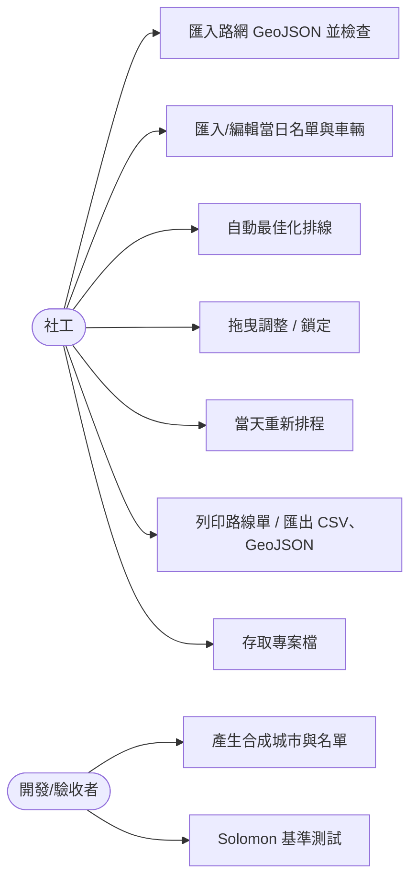
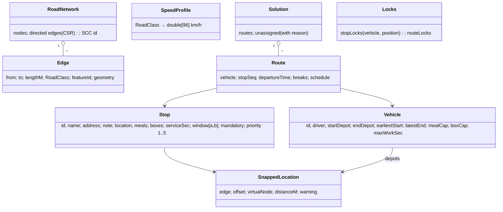
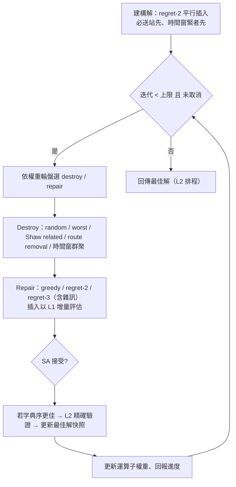

# MealRoute 社區送餐排班台 — 系統分析

> 狀態：**v1.0（2026-11-09 已確認：所有 🔶 決策採用建議方案）**。標示 🔶 的段落是需要你確認的決策點，彙整於文末〈待決事項〉。

---

## 1. 問題陳述

社區關懷據點每天兩個餐次（中午、傍晚）為 150–250 位獨居長者送餐。現況以紙本地圖人工排線，造成：

| 痛點 | 系統對應能力 |
|---|---|
| 超時、湯冷掉 | 硬性時間窗 + 時間相依行車時間（尖峰變慢）+ 最長工時 |
| 漏送 | 必送站「全數服務」為最高優先目標；無法服務者列出原因 |
| 臨時延誤/故障 | 當天重新排程，只動尚未出發服務的站 |
| 社工需人工微調 | 拖曳即時回饋（50 ms）、鎖定站點/路線 |

使用者：**社工（排班者）**，單機、單一使用者。產出物給**駕駛**（路線單）。

---

## 2. 使用案例



| UC | 主要流程 | 例外 |
|---|---|---|
| UC1 匯入路網 | 讀 GeoJSON → 建有向圖 → SCC → 地圖標示小分量 | 無效幾何：明確錯誤訊息（feature 索引、id、原因），不崩潰 |
| UC2 名單 | 站點吸附到最大 SCC 上最近路段 | 距離 > 150 m 或無可吸附路段 → 警告清單 |
| UC3 最佳化 | 設定時間上限/種子 → 背景執行、進度條 → 可取消 | 取消時保留目前最佳**完整可行**解 |
| UC4 拖曳 | 拖一站到另一路線/位置 → 50 ms 內顯示可行性、指標差異、第一個違反條件 → 放開才套用 | 鎖定的站不可拖 |
| UC5 重新排程 | 輸入回報（車、時刻、位置、已完成站、延誤分鐘或故障）→ 只重排未出發服務的站 | 故障車上的站 → 無法服務（附原因） |
| UC6 輸出 | 每位駕駛一份路線單；CSV（UTF-8 BOM）/GeoJSON | — |
| UC7 專案 | JSON 存讀，含路網參照、名單、車輛、解、鎖定 | 版本過新/損毀 → 明確訊息，不崩潰 |

---

## 3. 領域模型



### 3.1 名詞與約定

- **時刻**：當天 0 點起算的秒數（`double`）。時段 k = ⌊t/900⌋ mod 96。
- **行車時間**：只計路上移動；**工時** = 回到終點時刻 − 出發時刻（含等待、服務、休息）。
- **服務排程**：到達 `arr`；開始 `start = max(arr, a)`；需 `start ≤ b`；離開 `dep = start + service (+ 休息 1800 若在此休息)`。
- **容量**：所有餐盒出發前裝載，因此路線上 Σ需求 ≤ 容量（兩種維度各自檢查），無中途補貨。

---

## 4. 功能分析與關鍵演算法決策

### 4.1 GeoJSON 匯入與路網

- `System.Text.Json` 以 `Utf8JsonReader`/`JsonDocument` 自行解析 `FeatureCollection` → `LineString`（MultiLineString 不支援，視為錯誤並說明）。
- 端點座標**完全相同**（double 位元相等）才合併為同一節點；中間點不建節點（只作為幾何與長度）。
- oneway：`true`、`"yes"` → 順向；`"-1"` → 逆向（建一條 to→from 的邊，幾何反轉）；其他/缺少 → 雙向（兩條邊）。
- class 缺少 → `residential`；未知值 → 錯誤或警告？ 🔶（建議：**警告並視為 residential**）。
- 長度：haversine（R = 6,371,008.8 m）逐點相加。
- 無效幾何錯誤：座標不足 2 點、非數值、經緯度超出範圍、geometry 非 LineString、長度為 0。錯誤訊息格式：`Feature #12 (id=R-305): LineString 至少需要 2 個座標`。
- 結構：CSR（compressed sparse row）陣列，2–5 萬節點時記憶體約數 MB，Dijkstra cache-friendly。

### 4.2 強連通分量（SCC）

- **迭代版 Tarjan**（避免 5 萬節點遞迴 stack overflow），O(V+E)。
- 最大分量 = 節點數最多者（同數取最小 component id，確保決定性）。
- 其他分量 → 警告清單 + 地圖以警示色標示。

### 4.3 吸附（Snapping）

1. 候選路段：**兩端點都在最大 SCC** 的邊；以均勻網格空間索引（以折線的每個小段為單位）找附近候選，逐步擴大搜尋半徑。
2. 投影：對每個小段，以小段中點為原點做等距平面（equirectangular）投影，求點到線段的投影參數 `f ∈ [0,1]` 與距離。取距離最小者（同距離以 edge id 決定性破平手）。
3. 雙向道路的兩條有向邊**共用同一投影點與同一虛擬節點**；單行道只分割那一條有向邊 → 自然只能沿行車方向抵達/離開。
4. 投影點與任一端點 < 1 m → 直接使用該端點節點，不分割（避免零長度路段）。
5. **長度保持守恆**：分割後兩段長度以「前綴 haversine 長度 + f × 該小段 haversine 長度」計算，而非重算 haversine(A,P)+haversine(P,B)（後者因投影誤差不等於原長）。這樣 `len1 + len2 == 原長`（浮點誤差內）。
6. 同一條邊上多個站點：依沿線位置排序後一次切成多段。座標相同的多個站共用同一虛擬節點（站間行車時間 0）。
7. 產出 `SnappedNetwork`（基礎路網 + 虛擬節點的新 CSR），基礎路網本身不變；名單變動時重建（2 萬節點約數十 ms）。
8. 距離 > 150 m → 警告（仍吸附）；無可用路段 → 列為無法服務。

### 4.4 時間相依速度模型與 FIFO

邊長 L、進入時刻 t：

```
remaining = L
while true:
  k = slot(t); v = speed[class][k] (m/s)
  boundary = 900 * (floor(t/900) + 1)
  if v * (boundary - t) >= remaining: return t + remaining / v
  remaining -= v * (boundary - t); t = boundary
```

- **FIFO 證明（README 會寫）**：兩台車同路段，晚進入者在任一時刻所走距離都不超過早進入者（同時刻同速度），故不可能先到；路徑為邊的串接、單調函數合成仍單調 ⇒ 任意路徑 FIFO。
- 數值：邊界處以「時段索引」而非浮點比較決定速度，避免 `t` 剛好在邊界時取錯時段。

### 4.5 時間相依最短路徑（TD Dijkstra）

- 給定出發時刻的 **earliest-arrival Dijkstra**：標籤 = 到達時刻，鬆弛時以邊的到達函數計算。FIFO 保證 label-setting 正確。
- 二元堆積（`PriorityQueue<int,(double,int)>`，以 (時刻, 節點 id) 破平手 → 決定性）。
- 點對點查詢加 **A\***：啟發式 = haversine 距離 / 全域最高速度（admissible）。
- 起點可為「路段上某位置」（重新排程時車輛回報位置）：先算走完剩餘邊長的到達時刻作為初始標籤。

### 4.6 站間行車時間快取 🔶（核心架構決策）

**矛盾點**：最佳化每秒要做數十萬次站間行車時間查詢（每次要 µs 級），但任何用於判定可行性的時間必須與「實際出發時刻精確計算」誤差 ≤ 1 秒、且不得造成 FIFO 違反。純取樣內插做不到 1 秒保證；精確 profile search（分段線性函數）在 2 萬節點 × 200 站的規模下預處理太慢、太吃記憶體。

**建議方案：「取樣路徑快取 + 精確驗證」兩層式**

| 層 | 內容 | 用途 |
|---|---|---|
| L1 `PathSampledOracle` | 對每個關鍵地點（站 + 據點，≤ 330）在每個取樣時刻 tₖ（預設每 15 分鐘，涵蓋車輛可用時段）跑一次 one-to-all TD Dijkstra，記下到每個目的地的**最佳路徑**。路徑壓縮成「(道路等級, 長度) 連續段」序列（同等級相鄰邊合併 — 因為速度只看等級，合併後完全等價），每對 (i,j) 只存不重複的路徑。查詢 τ(i,j,t)：取 t 所在區間 [tₖ, tₖ₊₁] 兩端的路徑，**沿路徑精確積分**後取最小值。 | 最佳化內迴圈、增量評估、拖曳即時預覽 |
| L2 `ExactOracle` | 點對點 TD A\*，以 (i, j, t 的位元值) memo。 | 最終解的排程、報表、路線單、可行性判定的最終裁決 |

L1 的性質（可以證明，也會寫進 README 與性質測試）：
1. **永遠是某條真實路徑的精確時間** → ≥ 精確最短時間（上界），且在取樣點上 = 精確值。
2. **FIFO 保證**：每條路徑的到達函數單調不減，min 仍單調；相鄰區間在取樣點的值都等於精確值，接縫連續 ⇒ 全域單調不減。
3. 當 t 的最佳路徑屬於候選集合時與精確值完全相等；不相等的情形只會在區間內最佳路徑「換了第三條」時發生。
4. **自我修復**：L2 計算時若發現 L1 偏差 > 0.5 秒，把該最佳路徑加入該 (i,j,區間) 候選集合（不破壞性質 1、2）。

**可行性的最終判定一律以 L2 重算**：最佳化每產生一個新的最佳解、取消回傳前、拖曳放開後、重新排程結果、報表輸出，都以 L2 重算排程；若重算後不可行（極少見，例如休息規則因累計行車時間改變而觸發），由修復步驟移除違反站點再插入。拖曳預覽：先以 L1 立即回饋，再以 L2 重算受影響的兩條路線（預估 < 20 ms，仍在 50 ms 內）。

預處理成本估計（2 萬節點、215 地點、6 小時時段 → 25 個取樣點）：約 5,400 次 one-to-all Dijkstra × 2–4 ms ≈ 11–22 秒單執行緒；平行化（結果與執行緒數無關）後 4 核心約 3–6 秒，可滿足「匯入到第一個可行解 ≤ 15 秒」。記憶體：40k 對 × 平均 1–3 條壓縮路徑 × 數十 bytes ≈ 數 MB。

> 替代方案（不建議）：(a) 只用精確 A\* 不快取 — 最佳化每秒只能做數千次查詢，品質差；(b) 精確 profile search — 實作複雜度高、預處理不可控。

### 4.7 路線評估

**出發時刻策略** 🔶：解中明確記錄每條路線的據點出發時刻 `d`。建議：先以最早可出發時刻計算，再把出發時刻**延後到恰好消除第一站等待**（以 FIFO 到達函數反解，二分搜尋）。可避免「10:00 出發、11:30 才能服務」吃掉最長工時。可行性檢查器只驗證解中給定的 `d`，與策略無關。

**休息規則**：路線上累計行車時間（含回程）在超過 16,200 秒（4.5 h）之前，必須在某站服務結束後休息 1,800 秒並重新累計。休息放在哪一站會影響後續時刻（時間相依），故評估器以**標籤法**枚舉：每一站可選擇「休息 / 不休息」，保留在 (離開時刻, 累計行車, 已行車總和) 上非支配的標籤。路線通常 ≤ 30 站、最多 1–2 次休息，標籤數極少。結果是**在固定站序下最佳的休息位置**，與窮舉參考解的語意一致。不需要休息的路線不會插入休息（休息只會讓時刻變晚、不可能更好 — 但工時目標上保證不插）。

**評估結果**：可行與否、第一個違反（依時間順序）：站名、到達時刻、限制（時間窗 / 容量 / 工時 / 車輛時段 / 休息），以及目標五項的貢獻。

### 4.8 目標（字典序）

`(未服務必送站數, 未服務選送站優先權總和, 使用車輛數, 總行車時間, 總工時)`，以 tuple 精確比較。ALNS 的 simulated annealing 接受準則需要純量，使用「分層大權重」純量化只用於接受機率，**最佳解的比較永遠用字典序 tuple**。

### 4.9 最佳化演算法（ALNS）



- **永遠只維持可行狀態**：無法插入的站留在「未指派池」，由目標第 1、2 層懲罰。因此任何時刻的最佳解都是完整可行解（滿足取消驗收）。
- **決定性**：自製 `SplitMix64/Xoshiro256**` 亂數（不依賴 `System.Random` 演算法版本）；所有集合迭代順序固定。
- **多起點平行**：固定 R 條獨立 ALNS（種子 = 主種子衍生，R 不等於執行緒數），結束後以 (字典序, run index) 取最佳 ⇒ **結果與執行緒數無關**。
- **終止**：迭代上限（決定性的依據）、時間上限（安全停止）、CancellationToken。進度 = max(迭代比例, 時間比例)，以 running max 保證單調。
- **鎖定**：鎖定路線整條排除於搜尋外；鎖定站不可被 destroy 移除，repair 插入時保持其位置（見 4.10 🔶）。
- Solomon 靜態模式：同一套 ALNS，換成 `EuclideanOracle`、無休息/工時、目標 (車輛數, 總距離)；route removal 運算子負責減車。

### 4.10 鎖定 🔶

驗收 #15 寫「被鎖定的站仍在原車**原位置**」。兩種詮釋：

| 選項 | 語意 | 影響 |
|---|---|---|
| A. 絕對位置（建議，符合驗收字面） | 鎖定站固定在第 N 站 | 鎖定站之前的站數必須維持；實作：鎖定站把路線切成段，最後一個鎖定站之前的段只能做「段內交換/換入換出」，自由插入只發生在最後一個鎖定站之後 |
| B. 相對順序 | 鎖定站固定在該車，且與同車其他鎖定站的先後不變，未鎖定站可插在中間 | 搜尋彈性大，但「原位置」字面不成立 |

### 4.11 增量評估與拖曳回饋

- 每條路線快取前綴狀態（每站的標籤集合）。插入/移除/交換只從變動點往後重算，若某站的標籤集合與舊值相同即**提前收斂**直接沿用舊後綴。
- 200 站、15 車 ⇒ 每路線約 14 站，L1 查詢 ~1 µs，單次評估預估 10–50 µs（目標中位數 ≤ 1 ms）。
- 性質測試：隨機操作的增量結果 == 完整重算（同一 oracle）。
- 拖曳：`RouteEditor.Preview(move)` → `{可行, 五項指標 Δ, 第一個違反}`，例如「王奶奶 12:10 到，時間窗 11:30–12:00」。

### 4.12 當天重新排程 🔶

輸入：車輛、回報時刻 t_r、位置（吸附到路網，可在路段中間）、已完成站、延誤分鐘或故障。

處理規則（建議詮釋，請確認）：
1. **回報車（未故障）**：從回報位置於 `t_r + 延誤` 出發；剩餘載量 = 原裝載 − 已完成站需求；**只能服務原本分配給它且尚未完成的站**（可重排順序；無法準時的站 → 無法服務 + 原因）。累計行車時間 = 計畫中到最後一個完成站的累計值 + (t_r − 該站離開時刻)（保守假設其間都在開車）；工時從原出發時刻起算。
2. **故障車**：其未完成站 → 無法服務（原因：「車輛故障，餐盒在車上，不處理轉運」）。若故障車**尚未出發**，則餐盒仍在據點，其站開放給其他尚未出發的車？🔶（建議：是）
3. **其他已出發的車**：有回報者依回報；無回報者以「現在時刻」（TimeProvider）推定，**正在前往的那一站視為已出發服務（不可變）**，從該站之後可重排，同樣只能服務自己車上的站。
4. **尚未出發的車**：可服務任何未指派站（出發前在據點裝載）。
5. 已完成站、正在前往的站、鎖定的站/路線保持不變。

### 4.13 輸出

- 路線單：每位駕駛一頁 — 站序、預計到達、時間窗、地址/備註、餐盒/保溫箱、休息標示。時刻來自 L2 精確排程。
- 列印 🔶：建議 Win2D `CanvasPrintDocument` + `PrintManagerInterop`（WinUI 3 unpackaged 可用）；備案為輸出 HTML 交由瀏覽器列印。
- CSV：UTF-8 with BOM，欄位：vehicle_id, seq, stop_id, name, arrival, start, departure, meals, boxes, break_after…；GeoJSON：每路線一個 LineString（沿實際路徑幾何）+ 站點 Point，properties 含排程。兩者皆提供**再匯入**，往返內容相同（測試）。

### 4.14 專案檔

- JSON：`{ schemaVersion, network: { path, sha256 }, speedProfile, stops, vehicles, solution, locks, settings }`。
- `schemaVersion` > 支援版本 → 「此專案由較新版本建立（v3），目前僅支援至 v1」；JSON 損毀 → 指出行列位置；路網檔雜湊不符 → 警告。
- 預設位置 `%UserProfile%\Documents\MealRoute\`；設定 `%LocalAppData%\MealRoute\settings.json`。

---

## 5. 非功能需求

| 項目 | 目標 | 設計手段 |
|---|---|---|
| 拖曳回饋 | ≤ 50 ms | L1 增量評估（µs）+ L2 受影響路線重算 |
| 增量評估 | 中位數 ≤ 1 ms（200 站/15 車） | 前綴狀態 + 提前收斂 + 壓縮路徑 |
| 首個可行解 | 匯入 → ≤ 15 s（2 萬節點/200 站/15 車） | CSR、平行預處理、regret 建構 |
| 記憶體 | 峰值 ≤ 2 GB | CSR、路徑去重壓縮、不存 all-pairs × 全天 |
| 地圖 | 2 萬節點平移縮放流暢 | Win2D cached geometry、網格裁切、低倍率 LOD |
| 決定性 | 同種子同迭代上限 → 完全相同 | 自製 RNG、多起點固定數量、穩定破平手 |
| 時間 | 所有「現在」透過 `TimeProvider` | 測試用 `FakeTimeProvider` |

---

## 6. 驗收標準對照

| # | 驗收 | 主要元件 | 測試類型 |
|---|---|---|---|
| 1 | GeoJSON | `GeoJsonRoadReader`, `NetworkBuilder` | 單元 |
| 2 | SCC | `TarjanScc` vs 參考 Kosaraju | 性質 |
| 3 | 吸附 | `Snapper` | 單元 |
| 4 | 行車時間/FIFO | `EdgeTraversal` vs 參考逐段積分 | 性質 |
| 5 | TD 最短路徑 | `TdDijkstra` vs 參考（逐條路徑積分的 TD Dijkstra）/ 靜態 Dijkstra | 性質 |
| 6 | 快取 | `PathSampledOracle` vs `ExactOracle`/參考 | 性質 |
| 7 | 可行性 | 最佳化結果 vs 參考檢查器 | 性質 |
| 8 | 小型最佳 | ALNS vs 參考窮舉（200 組） | 性質 |
| 9 | Solomon | C1/R1/RC1 全部 29 例 | 效能（CLI，結果寫 README） |
| 10 | 決定性 | 不同執行緒數 → 相同結果 | 單元 |
| 11 | 字典序 | `Objective` | 單元 |
| 12 | 休息 | `RouteEvaluator` | 單元 |
| 13 | 增量 | `IncrementalEvaluator` | 性質 + 效能 |
| 14 | 拖曳 | `DragPreviewViewModel` | VM + 效能 |
| 15 | 鎖定 | ALNS + Locks | 單元 |
| 16 | 重新排程 | `Rescheduler` | 單元 |
| 17 | 取消/進度 | ALNS、Rescheduler | 單元 |
| 18 | 大型效能 | 全流程 | 效能（CLI，結果寫 README） |
| 19 | 路線單/匯出 | Reports | 單元 |
| 20 | 專案檔 | `ProjectSerializer` | 單元 |
| 21 | VM 聯動 | ViewModels | VM |
| 22 | ≥ 220 案例 | 全部 | — |
| 23 | README | — | 檢視 |
| 24 | CI | GitHub Actions | 檢視 |

### 6.1 窮舉參考解的可行性（#8）

9 站 × 3 車的全排列約 2,000 萬種，若每段都用 TD 參考計算，200 組在 CI 跑不完。設計：參考窮舉 = 「每車 × 每個站子集」以 DFS + 時間窗剪枝求最佳路線，再以子集 DP 合併各車（目標五項皆可跨路線相加，字典序可分解）。測試實例：**大部分使用靜態歐氏模式**（含時間窗與休息，拉大距離使路線超過 4.5 h 行車），**另含一小批 TD 小路網實例**，以控制 CI 時間在數分鐘內。

---

## 7. 待決事項（請確認）

1. **快取策略（4.6）**：L1 取樣路徑快取 + L2 精確驗證。是否接受？
2. **鎖定語意（4.10）**：A 絕對位置（建議）或 B 相對順序？
3. **出發時刻策略（4.7）**：延後出發以消除第一站等待（建議）或一律最早出發？
4. **重新排程詮釋（4.12）**：尤其「延誤車的站不轉給其他車」、「未出發即故障的車，其站開放給其他未出發車」、「其他已出發車正在前往的站不可變」。
5. **未知 class 值（4.1）**：警告並視為 residential（建議）或視為錯誤？
6. **列印（4.13）**：Win2D CanvasPrintDocument（建議）或 HTML 由瀏覽器列印？
7. **套件清單**（見架構文件 §7）。
8. **GitHub repository**：CI 徽章需要 repo 的 owner/name；目前目錄不是 git repo，開發開始時會 `git init`。
