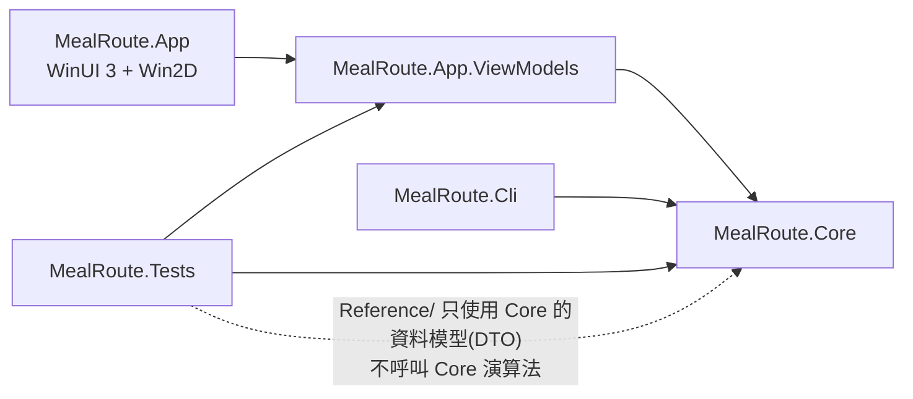
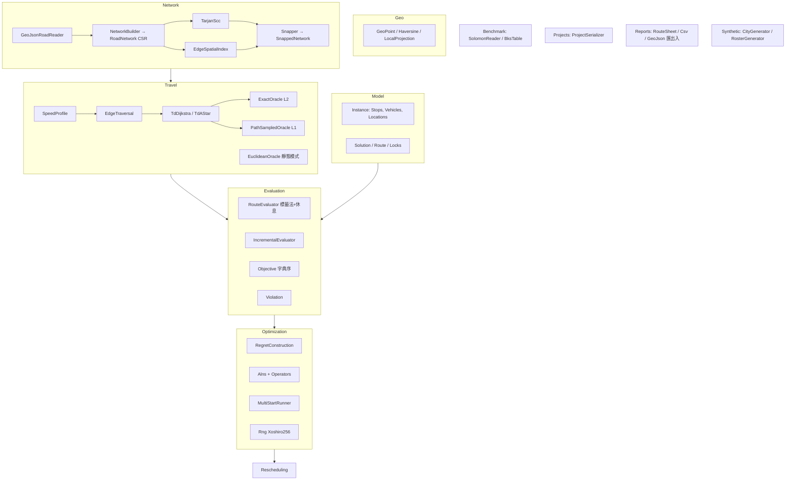
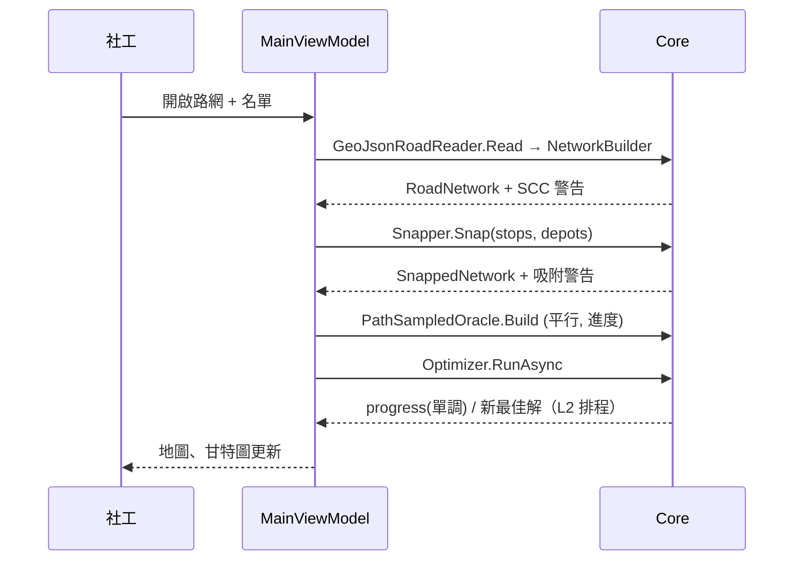
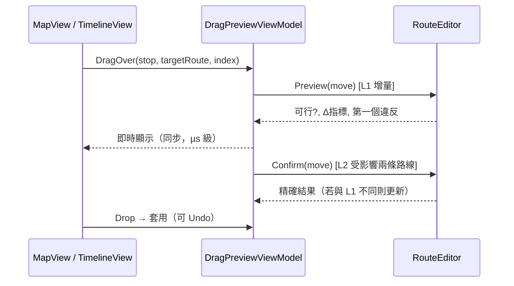

# MealRoute 社區送餐排班台 — 系統架構

> 狀態：**v1.0（2026-11-09 已確認：所有 🔶 決策採用建議方案）**。搭配 [01-system-analysis.md](01-system-analysis.md) 閱讀。

---

## 1. 方案結構

```
MealRoute.sln
├─ src/
│  ├─ MealRoute.Core/                 net9.0（純計算，無 UI / Windows 依賴）
│  ├─ MealRoute.App.ViewModels/       net9.0（MVVM，CommunityToolkit.Mvvm）
│  └─ MealRoute.App/                  net9.0-windows10.0.19041.0，WinUI 3 unpackaged + Win2D
├─ tools/
│  └─ MealRoute.Cli/                  net9.0：合成城市/名單產生器、Solomon 基準、效能量測
├─ tests/
│  └─ MealRoute.Tests/                xUnit；參考實作在 Reference/（不引用 Core 演算法）
├─ samples/  small/ medium/ large/    產生器輸出 + EXPECTED.md（預期結果與檢查方式）
├─ benchmarks/solomon/                C1/R1/RC1 實例檔 + bks.json（來源註明）
├─ docs/
└─ .github/workflows/ci.yml
```

### 1.1 相依方向



規則：
- Core 不得引用任何 UI/Windows 組件；VM 不得引用 WinUI 型別（透過介面抽象 UI 服務）。
- App 只含 XAML 檢視、Win2D 繪製、UI 服務實作（檔案對話框、Dispatcher、列印）。
- 參考實作：Tests 專案的 `Reference/` 資料夾，可讀 Core 的**資料模型**（Stop、Vehicle、Solution 等純資料 record），但自行實作 haversine、Dijkstra、TD 積分、可行性檢查、窮舉。以一個架構測試（反射掃描 `Reference` 命名空間的 IL 呼叫目標）確保它沒呼叫 Core 的演算法命名空間。

---

## 2. Core 模組



### 2.1 關鍵介面（草案）

```csharp
// 所有時刻：當天 0 點起算秒數
public interface ITravelTimeOracle
{
    double ArrivalTime(int fromLoc, int toLoc, double departure); // FIFO 保證
    double TravelDistance(int fromLoc, int toLoc, double departure); // 報表/匯出用
}

public sealed class RouteEvaluator
{
    RouteEvaluation Evaluate(Instance inst, VehicleRef v, ReadOnlySpan<int> stops, EvaluationMode mode);
    // mode: Fast（遇不可行即停）/ Diagnostic（續算並記錄第一個違反）
}

public readonly record struct ObjectiveValue(
    int UnservedMandatory, int UnservedOptionalPriority, int VehiclesUsed,
    double TotalTravelSeconds, double TotalWorkSeconds) : IComparable<ObjectiveValue>;

public sealed class Optimizer
{
    Task<OptimizationResult> RunAsync(Instance inst, Solution? start, Locks locks,
        OptimizerOptions opt, IProgress<OptimizationProgress>? progress, CancellationToken ct);
}

public sealed class RouteEditor  // 拖曳/手動調整
{
    MovePreview Preview(SolutionState s, Move move);   // L1，µs 級
    MovePreview Confirm(SolutionState s, Move move);   // L2 精確重算受影響路線
}

public sealed class Rescheduler
{
    Task<RescheduleResult> RunAsync(Instance inst, Solution current,
        IReadOnlyList<VehicleReport> reports, Locks locks, OptimizerOptions opt,
        IProgress<OptimizationProgress>? progress, CancellationToken ct);
}
```

### 2.2 資料結構

| 結構 | 內容 | 理由 |
|---|---|---|
| `RoadNetwork` | `double[] lat, lon`；`int[] firstOut, head`；`float/double[] length`；`byte[] cls`；幾何以 offset 陣列存 | CSR：5 萬節點仍小、Dijkstra 快 |
| `SnappedNetwork` | 基礎 CSR + 虛擬節點重建的 CSR，`LocationId → NodeId` | 名單變動時重建，基礎不變 |
| 壓縮路徑 | `(byte cls, double len)[]`（同等級連續邊合併） | 速度只依等級 → 等價且評估快 |
| 路線狀態 | `int[] stops` + 每站標籤（到達、開始、離開、累計行車、載量） | 增量評估的前綴快取 |
| 解快照 | 不可變 `Solution` record | 取消時直接回傳，不會半套 |

---

## 3. 關鍵流程

### 3.1 匯入到第一個可行解



### 3.2 拖曳回饋（≤ 50 ms）



### 3.3 重新排程

```mermaid
flowchart TD
  A[VehicleReport 清單] --> B[凍結: 已完成站、正在前往的站、鎖定]
  B --> C[每台已出發車: 新起點=回報位置(吸附於路段中) 新起時=回報時刻+延誤<br/>剩餘載量、累計行車、已用工時]
  C --> D[故障車未完成站 → 無法服務(原因)]
  D --> E[建立子問題: 已出發車只能服務自己的站<br/>未出發車可服務任何未指派站]
  E --> F[同一 ALNS 求解（可取消、進度）]
  F --> G[合併回原解 → L2 精確排程]
```

---

## 4. ViewModels

| ViewModel | 職責 |
|---|---|
| `MainViewModel` | 專案開關存、匯入流程、警告清單、命令列 |
| `MapViewModel` | 圖層資料（路網、站點、路線 polyline、小分量標示）、視窗座標轉換、命中測試、選取 |
| `TimelineViewModel` | 每車一列甘特條（行車/等待/服務/休息）、時間刻度、選取 |
| `SelectionService` | 地圖 ↔ 時間軸 ↔ 清單聯動的單一事實來源 |
| `DragPreviewViewModel` | 拖曳預覽、指標 Δ、第一個違反訊息、套用/取消 |
| `LockViewModel` | 鎖站/鎖路線命令與狀態 |
| `OptimizationViewModel` | 參數（時間/迭代上限、種子）、進度、取消 |
| `RescheduleViewModel` | 回報輸入精靈：選車 → 時刻 → 位置（地圖點選）→ 已完成站 → 延誤/故障 → 執行 → 比較前後 |
| `RouteSheetViewModel` | 路線單資料、列印、匯出 |

UI 服務介面（VM 定義、App 實作）：`IFileDialogService`、`IUiDispatcher`、`IPrintService`、`ISettingsStore`、`IMessageService`。所有「現在」取自注入的 `TimeProvider`。

---

## 5. App（WinUI 3 + Win2D）

- **地圖** `CanvasControl`：
  - 投影：以路網中心的 equirectangular 平面座標（公尺），`Matrix3x2` 做平移縮放。
  - 路網依網格分塊建立 `CanvasGeometry`，縮放停止時（debounce）以 `CanvasCachedGeometry.CreateStroke` 重建快取；平移只改 transform；視窗外分塊裁切；低倍率時只畫 arterial/collector（LOD）。
  - 路線依車輛著色並沿線畫方向箭頭；站點依狀態（已服務、未服務、鎖定、警告）不同符號。
- **時間軸** `CanvasControl`：每車一列，四色區段；點選與地圖聯動；可拖曳站點到其他列/位置。
- **列印**：Win2D `CanvasPrintDocument` + `PrintManagerInterop`（🔶 見分析文件）。
- unpackaged：`WindowsPackageType=None`、`WindowsAppSDKSelfContained=true`，發佈 win-x64。

---

## 6. 測試策略

| 類別 | 內容 | 數量目標 |
|---|---|---|
| 單元 | GeoJSON、吸附、休息、字典序、鎖定、重新排程、匯出入、專案檔、取消/進度、決定性 | ~150 |
| 性質（≥ 8 組） | SCC、行車時間積分、FIFO、TD 最短路徑、快取誤差與 FIFO、可行性、窮舉最佳、增量一致性 | ≥ 10 組 |
| ViewModel | 聯動、鎖定、重新排程流程、進度、拖曳回饋時間 | ~40 |
| 效能 | 增量評估中位數、拖曳 50 ms（CI 中以寬鬆門檻 + Trait 標記）；Solomon、大型實例走 CLI | — |

- 性質測試以自製小型 `Property.ForAll(seedBase, count, gen, check)`：固定種子，失敗時訊息含可重現種子（不引入 FsCheck）。
- 參考實作清單（`tests/MealRoute.Tests/Reference/`）：
  - `RefHaversine`、`RefStaticDijkstra`（簡單陣列 O(V²) 版）
  - `RefTdIntegrator`：以「距離為主迴圈」逐時段積分（不同於正式的時間為主迴圈寫法）
  - `RefTdDijkstra`：以參考積分器做 TD Dijkstra
  - `RefSccKosaraju`
  - `RefFeasibilityChecker`：只讀 Instance + Solution（含出發時刻與休息位置），自行重算所有時刻
  - `RefExhaustiveSolver`：DFS + 子集 DP

---

## 7. 套件清單（需你同意）

| 套件 | 用途 | 授權 |
|---|---|---|
| Microsoft.WindowsAppSDK | WinUI 3 | MIT |
| Microsoft.Graphics.Win2D | 地圖/時間軸繪製 | MIT |
| CommunityToolkit.Mvvm | MVVM | MIT |
| xunit、xunit.runner.visualstudio、Microsoft.NET.Test.Sdk | 測試 | Apache-2.0 / MIT |
| Microsoft.Extensions.TimeProvider.Testing | `FakeTimeProvider` | MIT |

不使用任何路徑規劃/VRP/最佳化套件；GeoJSON 以 System.Text.Json 自行解析。

---

## 8. CI（GitHub Actions）

`windows-latest`：checkout → setup-dotnet `9.0.x` → `dotnet build -c Release` → `dotnet test`（排除 `Category=Benchmark`）→ `dotnet publish src/MealRoute.App -c Release -r win-x64` → `upload-artifact`。README 放徽章。

---

## 9. 開發里程碑（每步可編譯、可測試、獨立 commit）

| M | 內容 | 對應驗收 |
|---|---|---|
| 0 | 方案骨架、CI、Property 測試工具 | 24 |
| 1 | Geo、GeoJSON、RoadNetwork、SCC + 參考 | 1, 2 |
| 2 | 空間索引、吸附、SnappedNetwork | 2, 3 |
| 3 | 速度模型、TD Dijkstra/A\* + 參考 | 4, 5 |
| 4 | L1/L2 Oracle 快取 | 6 |
| 5 | 模型、RouteEvaluator（休息標籤法）、目標、參考檢查器 | 7, 11, 12 |
| 6 | 建構 + ALNS + 多起點、決定性、取消/進度、窮舉參考 | 7, 8, 10, 17 |
| 7 | Solomon 讀取 + 基準 CLI + BKS 表 | 9 |
| 8 | 增量評估、RouteEditor、鎖定 | 13, 14, 15 |
| 9 | 重新排程 | 16, 17 |
| 10 | 專案檔、匯出入、路線單 | 19, 20 |
| 11 | 合成產生器 + 三組範例 + EXPECTED.md | 交付物、18 |
| 12 | ViewModels | 14, 21 |
| 13 | WinUI 3 App + Win2D | 地圖/時間軸 |
| 14 | 效能調校、README、截圖 | 18, 22, 23 |

主要風險：(1) L1 預處理時間在 CI 4 核心機器上的表現；(2) Solomon R1/RC1 達到 BKS+1 車與 105% 距離需要足夠的 ALNS 時間；(3) WinUI 3 unpackaged 列印與 CI 發佈的設定細節。每個風險都在對應里程碑先做量測再擴充。
