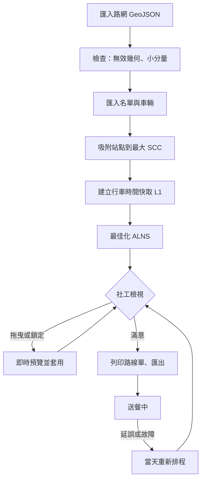
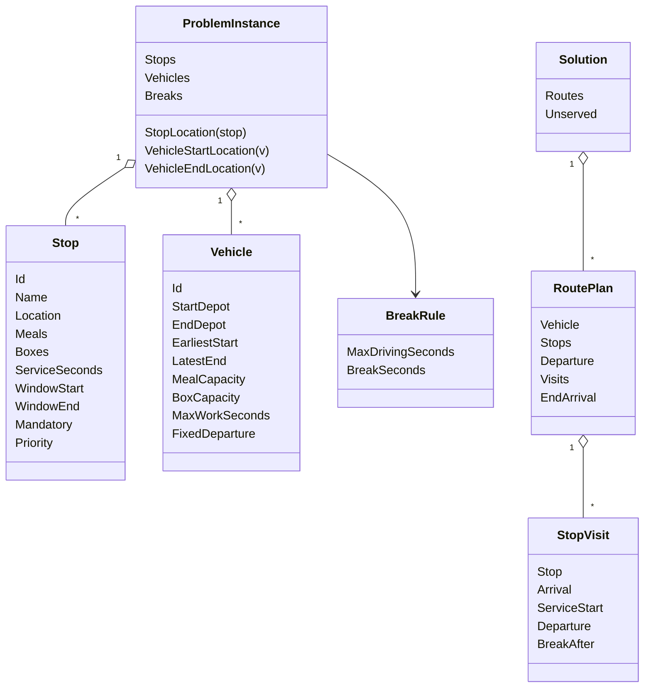
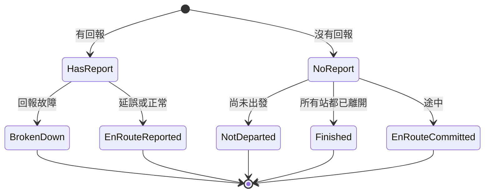

# 02 系統分析

本章把第 01 章的需求拆成系統行為：一天的排班怎麼走、核心資料長什麼樣、哪個需求落在哪個檔案。

## 1. 主要業務流程

這張圖看「社工的一天」：前半段是排班前的準備與最佳化，後半段是送餐當中的應變。

重點：

- **E（快取）是分水嶺**：它之前都是「資料整備」，之後所有計算都靠它快速查詢行車時間。名單變動（吸附點改變）就必須重建，所以 `PlanningWorkspace.SetRosterAsync()` 會清掉舊的解與鎖定。
- **G ↔ H 是互動迴圈**：每次拖曳只重算受影響的兩條路線，才能做到 50 ms 內回饋。
- **K 回到 G**：重新排程的結果和最佳化結果一樣進入編輯器，可以再拖曳、可以復原。

## 2. 核心使用情境

### 情境 A：開啟專案並得到第一個可行解

- **前置條件**：有專案檔（`*.mealroute.json`），且它參照的路網檔在本機或專案資料夾內。
- **主要步驟**：
  1. 讀專案檔 → 檢查路網路徑是否允許、雜湊是否相符。
  2. 讀 GeoJSON → 建圖 → SCC 分析 → 列出小分量警告。
  3. 吸附所有站點與據點（虛擬節點切開路段）→ 列出吸附警告。
  4. 建 L1 快取（平行、可回報進度）。
  5. 若專案中存有解且仍符合車輛數，載入它；否則以「全部未排」開始。
- **例外**：路網是網路路徑 → 拒絕並請使用者手動匯入；路網檔被修改過 → 警告但繼續；JSON 損毀 → 指出第幾行附近無法解析。

### 情境 B：拖曳一站到另一條路線

- **前置條件**：已有解；被拖的站沒有鎖定。
- **主要步驟**：
  1. 開始拖曳 → `DragPreviewViewModel.Begin()`。
  2. 滑過目標位置 → 先用 L1 預覽（微秒級），再用 L2 精確重算受影響的兩條路線。
  3. 顯示「可行」或第一個違反條件，以及「車輛 ±0｜行車 +3 分｜工時 −5 分」這類差異。
  4. 放開 → 套用（推入復原堆疊）；不可行的移動要按住 Shift 才能強制套用。
- **例外**：移動會改變鎖定站或鎖定路線 → 拒絕並說明是哪一個鎖定。

### 情境 C：送餐途中一台車延誤 30 分鐘

- **前置條件**：計畫已在執行；社工收到駕駛回報。
- **主要步驟**：
  1. 在「重新排程」頁籤選車、勾選已完成站、在地圖點選目前位置、輸入延誤 30 分。
  2. 系統把這台車轉換成「從回報位置、於回報時刻＋30 分固定出發、只能服務自己剩下的站、載量＝剩餘餐盒」的新車輛。
  3. 其他車依狀態處理（見下方狀態圖），用同一個最佳化器求解。
  4. 顯示前後比較 → 套用（可復原）。
- **例外**：延誤後某些站趕不上 → 列為未服務並附原因（車上餐盒不轉給其他車）。

## 3. 領域模型

只列核心型別與關鍵欄位。這張圖看「資料怎麼關聯」：`ProblemInstance` 是一次計算的輸入，`Solution` 是輸出，兩者都是不可變的 record。

定義在 `src/MealRoute.Core/Model/Stop.cs`、`src/MealRoute.Core/Model/ProblemInstance.cs`、`src/MealRoute.Core/Model/Solution.cs`。

值得注意的設計：

- **地點用整數索引**：行車時間 oracle 只認「地點編號」，`ProblemInstance` 規定順序為「站點 [0, S)、出發據點 [S, S+V)、回程據點 [S+V, S+2V)」。這讓 oracle 可以用二維陣列查表，也讓吸附警告的 `L0`、`L1` 可以反查回站名（`ProblemInstance.DescribeLocation()`）。
- **解裡明確記錄出發時刻與休息位置**：`RoutePlan.Departure`、`StopVisit.BreakAfter`。因此參考檢查器只需「驗證這份排程」，不必知道評估器用什麼策略選出發時刻。📄 `docs/01-system-analysis.md` §4.7。
- **Vehicle 同時承載「重新排程的狀態」**：`InitialDrivingSeconds`、`WorkStartedAt`、`FixedDeparture` 三個欄位平常是預設值，只有重新排程時才會被設定。這是把「途中的車」轉換成「一台普通的車」的關鍵（見 07 章 Rescheduling 小節）。

## 4. 狀態轉換

### 4.1 重新排程時的車輛狀態

`src/MealRoute.Core/Rescheduling/Rescheduler.cs` 的 `VehicleState` 決定每台車在子問題中能做什麼。這張圖看「一台車怎麼被分類」：

| 狀態 | 在子問題中可服務的站 | 出發 |
|---|---|---|
| `NotDeparted` | 任何釋出或未指派的站 | 不早於「現在」 |
| `EnRouteReported` | 只有自己剩下的站 | 回報位置，回報時刻＋延誤（固定） |
| `EnRouteCommitted` | 只有「正在前往的站」之後的自己的站 | 該站的計畫離開時刻（固定） |
| `BrokenDown` | 無；已出發則剩下的站列為無法服務，未出發則釋出給其他車 | — |
| `Finished` | 無 | — |

### 4.2 最佳化執行的生命週期

`OptimizationViewModel` 的狀態很單純：閒置 → 執行中（`IsRunning`）→ 完成或取消 → 閒置。取消不是「中斷丟棄」，而是「停止搜尋並交出目前最佳的完整可行解」，所以兩者在 UI 上走同一條結束路徑。

## 5. 需求追溯表

| 需求 | 主要實作 | 主要測試 |
|---|---|---|
| FR-01 GeoJSON | `src/MealRoute.Core/GeoJson/GeoJsonRoadReader.cs`、`src/MealRoute.Core/Network/NetworkBuilder.cs` | `tests/MealRoute.Tests/GeoJson/GeoJsonRoadReaderTests.cs`、`tests/MealRoute.Tests/Network/NetworkBuilderTests.cs` |
| FR-02 SCC | `src/MealRoute.Core/Network/StronglyConnectedComponents.cs`、`src/MealRoute.Core/Network/NetworkAnalysis.cs` | `tests/MealRoute.Tests/Network/StronglyConnectedComponentsTests.cs` |
| FR-03 吸附 | `src/MealRoute.Core/Network/Snapper.cs`、`src/MealRoute.Core/Network/SegmentSpatialIndex.cs` | `tests/MealRoute.Tests/Network/SnapperTests.cs` |
| FR-04 行車時間 | `src/MealRoute.Core/Travel/SpeedProfile.cs`、`src/MealRoute.Core/Travel/TimeDependentDijkstra.cs`、`src/MealRoute.Core/Travel/PathSampledOracle.cs`、`src/MealRoute.Core/Travel/ExactOracle.cs` | `tests/MealRoute.Tests/Travel/` |
| FR-05、05a 路線評估 | `src/MealRoute.Core/Evaluation/RouteEvaluator.cs` | `tests/MealRoute.Tests/Evaluation/RouteEvaluatorTests.cs`、`tests/MealRoute.Tests/Evaluation/RouteEvaluatorPropertyTests.cs` |
| FR-05b、06、07 最佳化 | `src/MealRoute.Core/Optimization/Optimizer.cs`、`src/MealRoute.Core/Optimization/AlnsRun.cs`、`src/MealRoute.Core/Evaluation/ObjectiveValue.cs` | `tests/MealRoute.Tests/Optimization/` |
| FR-08 拖曳 | `src/MealRoute.Core/Editing/PlanEditor.cs`、`src/MealRoute.App.ViewModels/DragPreviewViewModel.cs` | `tests/MealRoute.Tests/Editing/PlanEditorTests.cs`、`tests/MealRoute.Tests/ViewModels/MainViewModelTests.cs` |
| FR-09 鎖定 | `LockSet`（`src/MealRoute.Core/Optimization/OptimizerOptions.cs`）、`PlanEditor` | `tests/MealRoute.Tests/Optimization/LockTests.cs` |
| FR-10 重新排程 | `src/MealRoute.Core/Rescheduling/Rescheduler.cs`、`src/MealRoute.App.ViewModels/RescheduleViewModel.cs` | `tests/MealRoute.Tests/Rescheduling/ReschedulerTests.cs` |
| FR-11 輸出 | `src/MealRoute.Core/Reports/` | `tests/MealRoute.Tests/Projects/ProjectAndExportTests.cs` |
| FR-12 專案檔 | `src/MealRoute.Core/Projects/ProjectSerializer.cs` | 同上 |
| FR-13 聯動 | `src/MealRoute.App.ViewModels/SelectionService.cs` | `tests/MealRoute.Tests/ViewModels/MainViewModelTests.cs` |
| FR-14 產生器、基準 | `src/MealRoute.Core/Synthetic/`、`src/MealRoute.Core/Benchmark/SolomonInstance.cs`、`tools/MealRoute.Cli/` | `tests/MealRoute.Tests/Synthetic/GeneratorTests.cs`、`tests/MealRoute.Tests/Benchmark/SolomonTests.cs` |
| FR-15 復原 | `PlanEditor.Undo()`、`PlanEditor.Redo()` | `tests/MealRoute.Tests/Editing/PlanEditorTests.cs` |
| FR-16 CLI 站名 | `ProblemInstance.DescribeLocation()`、`TravelModel.LocationOf()` | `tests/MealRoute.Tests/Planning/LocationLabelTests.cs` |
| FR-17 測試報告 | `.github/workflows/ci.yml`、`docs/test-report.md` | CI 執行頁面 |
