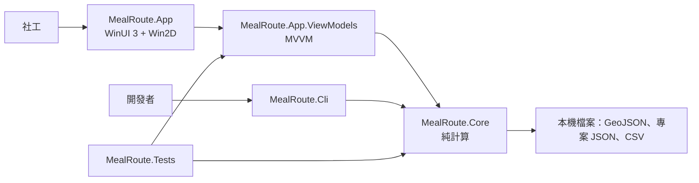
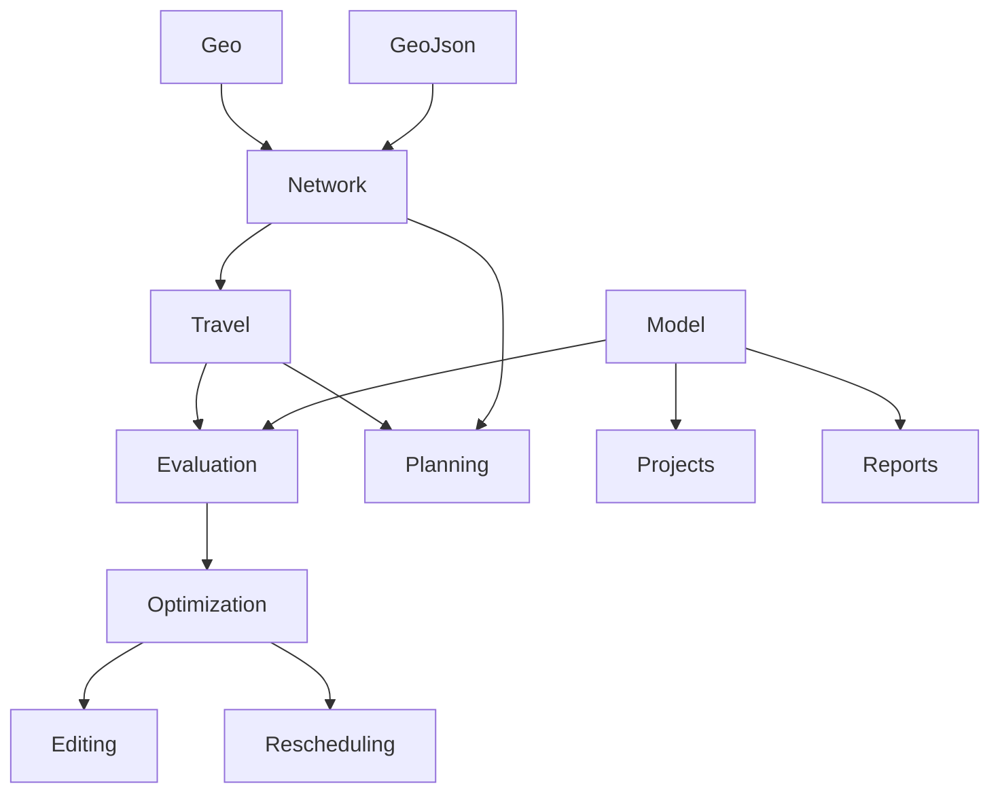

# 03 架構設計

## 1. 整體架構

這張圖看「誰依賴誰」：所有計算集中在 `MealRoute.Core`，UI 只是它的一個使用者，CLI 和測試是另外兩個使用者。



沒有資料庫、沒有伺服器、沒有外部服務。所有輸入輸出都是本機檔案。

## 2. 分層與職責

| 層 | 專案 | Target | 職責 | 不可以做的事 |
|---|---|---|---|---|
| 計算核心 | `src/MealRoute.Core` | `net9.0` | 路網、行車時間、評估、最佳化、編輯、重新排程、檔案格式 | 引用任何 UI 或 Windows 組件 |
| 展示邏輯 | `src/MealRoute.App.ViewModels` | `net9.0` | 狀態、命令、背景工作協調、選取聯動 | 引用 WinUI 型別（UI 能力透過介面取得） |
| 檢視 | `src/MealRoute.App` | `net9.0-windows10.0.19041.0` | XAML、Win2D 繪製、UI 服務實作（檔案對話框、列印） | 放業務邏輯 |
| 工具 | `tools/MealRoute.Cli` | `net9.0` | 產生範例、命令列求解、Solomon 基準 | — |
| 測試 | `tests/MealRoute.Tests` | `net9.0` | 單元、性質、ViewModel、端對端測試與獨立參考實作 | — |

> 📄 依據：`docs/02-architecture.md` §1.1 的規則；README「架構」。

**這個切法的價值**：Core 與 ViewModels 都是純 `net9.0`，所以 254 個測試（含 ViewModel 測試）在 CI 上不需要啟動任何視窗就能跑完。WinUI 的部分只剩「把 ViewModel 的狀態畫出來」。

## 3. 目錄結構導覽

```
MealRoute.sln
├── src/
│   ├── MealRoute.Core/
│   │   ├── Geo/            haversine、折線累計長度、點到線段投影
│   │   ├── GeoJson/        GeoJSON 讀取（System.Text.Json 自行解析）
│   │   ├── Network/        CSR 路網、Tarjan SCC、空間索引、吸附
│   │   ├── Travel/         速度模型、TD Dijkstra/A*、L1/L2 oracle、歐氏 oracle
│   │   ├── Model/          Stop、Vehicle、ProblemInstance、Solution（純資料 record）
│   │   ├── Evaluation/     RouteEvaluator、ObjectiveValue、Violation
│   │   ├── Optimization/   Optimizer、AlnsRun、SearchState、Rng、LockSet
│   │   ├── Editing/        PlanEditor（拖曳預覽、復原）
│   │   ├── Rescheduling/   Rescheduler
│   │   ├── Planning/       TravelModel：吸附＋L1＋L2 的組裝
│   │   ├── Projects/       專案檔、名單 CSV
│   │   ├── Reports/        路線單、路線 CSV、路線 GeoJSON
│   │   ├── Benchmark/      Solomon 讀取、BKS 表
│   │   └── Synthetic/      合成城市與名單產生器
│   ├── MealRoute.App.ViewModels/
│   │   ├── PlanningWorkspace.cs   一個排班日載入的所有東西
│   │   ├── MainViewModel.cs       專案生命週期、匯入、警告、子 ViewModel
│   │   ├── *ViewModel.cs          地圖、時間軸、拖曳、最佳化、重新排程、路線單
│   │   └── Services/              UI 服務介面、設定檔
│   └── MealRoute.App/
│       ├── Views/                 MapView、TimelineView（Win2D CanvasControl）
│       └── Services/              WinUI 版的服務實作、Win2D 列印
├── tools/MealRoute.Cli/           generate、solve、solomon 三個指令
├── tests/MealRoute.Tests/
│   ├── Reference/                 與正式程式碼互相獨立的參考實作
│   ├── Infrastructure/            自製性質測試執行器
│   └── <對應 Core 的資料夾>/
├── samples/                       small、medium、large 三組範例與 EXPECTED.md
├── benchmarks/solomon/            29 個 Solomon 實例、bks.json、RESULTS.md
└── docs/                          設計文件、測試報告、本教學文件
```

## 4. Core 內部的模組相依

這張圖看「計算的管線」：每一層只往下依賴，沒有循環。



- `Planning/TravelModel` 是「組裝點」：把吸附、L1、L2 包成一個物件，App 與 CLI 都只呼叫 `TravelModel.Build()`，不需要知道三者的建構順序。
- `Editing` 依賴 `Optimization` 只是為了 `LockSet`（鎖定規則與最佳化器共用）。🔍 `LockSet` 放在 `OptimizerOptions.cs` 裡，從檔名不容易找到，是可以改進的地方。

## 5. 使用到的設計模式

### 5.1 MVVM 與 UI 服務介面

ViewModel 需要開檔案對話框、顯示訊息、切回 UI 執行緒、列印，這些都是 WinUI 的能力。做法是 ViewModel 層定義介面，App 層實作：

| 介面（`src/MealRoute.App.ViewModels/Services/Services.cs`） | App 實作 | 測試替身 |
|---|---|---|
| `IFileDialogService` | `WinUiFileDialogService` | `tests/MealRoute.Tests/ViewModels/ViewModelTestKit.cs` 中的假物件 |
| `IUiDispatcher` | `WinUiDispatcher` | `InlineDispatcher`（直接同步執行） |
| `IMessageService` | `ContentDialogMessageService` | 假物件 |
| `IPrintService` | `Win2DPrintService` | 假物件 |

不用這個模式的代價：ViewModel 測試必須啟動 WinUI，CI 上很難跑，拖曳延遲這種需求就只能手測。

組裝點在 `src/MealRoute.App/MainWindow.xaml.cs` 的建構子：手動 `new` 出所有服務傳給 `MainViewModel`。🔍 沒有使用 DI 容器，推測是因為只有一個視窗、相依關係少，手動組裝反而更直接（文件未記載選用原因）。

### 5.2 單一事實來源（Single Source of Truth）的選取狀態

`SelectionService` 只有兩個屬性：`SelectedStop`、`SelectedVehicle`。地圖、時間軸、資訊面板都綁定它，而不是互相通知。好處是「點地圖 → 時間軸高亮」與「點時間軸 → 地圖高亮」走同一條路，不會出現 A 通知 B、B 又通知 A 的迴圈。

### 5.3 策略介面：`ITravelTimeOracle`

`RouteEvaluator` 只依賴 `ITravelTimeOracle`，有三個實作：

| 實作 | 用途 |
|---|---|
| `PathSampledOracle`（L1） | 最佳化內迴圈，微秒級 |
| `ExactOracle`（L2） | 最終裁決、路線單、拖曳確認 |
| `EuclideanOracle` | Solomon 靜態模式、小型測試 |

同一個評估器、同一個最佳化器，換一個 oracle 就能跑 Solomon 基準。`Optimizer` 建構時收兩個 oracle（搜尋用、精確用），兩者是同一個物件時就跳過精確化步驟（`SameOracle`）。

### 5.4 不可變資料 ＋ 可變工作狀態

`Solution`、`RoutePlan`、`StopVisit` 都是不可變 record；最佳化內部用可變的 `SearchState`（`src/MealRoute.Core/Optimization/SearchState.cs`）。對外只交出不可變的快照，所以「取消時回傳目前最佳解」不會拿到改到一半的資料。📄 `docs/02-architecture.md` §2.2「解快照：不可變 Solution record，取消時直接回傳，不會半套」。

### 5.5 把特殊情況轉換成一般情況

重新排程沒有寫一個新的求解器，而是把「途中的車」改寫成一台普通的 `Vehicle`：出發據點＝回報位置、最早出發＝回報時刻＋延誤（並設 `FixedDeparture`）、容量＝剩下的餐盒、`InitialDrivingSeconds`＝已累計行車。再加一個「哪台車可以服務哪一站」的限制函數 `canServe`，就能直接交給 `Optimizer`。這是本專案最值得帶走的設計之一，細節見 07 章。

## 6. 橫切關注點

| 關注點 | 做法 | 位置 |
|---|---|---|
| 時間 | 所有「現在」都經由注入的 `TimeProvider`；時刻一律是「當天 0 點起算的秒數」（`double`） | `OptimizerOptions.TimeProvider`、`MainViewModel` 建構子 |
| 錯誤處理 | 使用者可修正的錯誤用專用例外並帶中文訊息（`GeoJsonFormatException`、`ProjectFileException`）；逐筆資料問題收集成 `ImportIssue` 清單而不是丟例外；未預期的 UI 例外寫入 `%LocalAppData%\MealRoute\crash.log` 後照常崩潰（不吞掉） | `src/MealRoute.Core/GeoJson/RoadFeature.cs`（`ImportIssue`、`GeoJsonFormatException`）、`src/MealRoute.Core/Projects/ProjectData.cs`、`src/MealRoute.App/App.xaml.cs` |
| 設定 | `JsonSettingsStore`：讀不到就用預設值並記 Trace 警告（設定只是便利功能） | `src/MealRoute.App.ViewModels/Services/Services.cs` |
| 執行緒 | 最佳化、重新排程、快取建立都在背景；進度透過 `IUiDispatcher` 回 UI 執行緒；L1 查詢是執行緒安全的，`ExactOracle` 用物件池給每個執行緒一個 Dijkstra 工作區 | `OptimizationViewModel`、`ExactOracle` |
| 取消 | 每個長時間工作都收 `CancellationToken`；最佳化每次迭代檢查一次 | `Optimizer.Run()`、`PathSampledOracle.Build()` |
| 決定性 | 自製亂數 `Rng`；集合迭代順序固定；平行結果依（目標值, run 編號）選取 | `src/MealRoute.Core/Optimization/Rng.cs`、`Optimizer.Run()` |
| 安全 | 專案檔參照的路網路徑走白名單；CSV 文字欄防公式注入 | `PlanningWorkspace.IsAllowedReferencedPath()`、`src/MealRoute.Core/Reports/CsvText.cs` |
| 建置品質 | `TreatWarningsAsErrors`、`AnalysisLevel=latest-recommended`、`Nullable=enable` 全專案共用 | `Directory.Build.props` |

## 7. 與設計文件的差異

`docs/02-architecture.md` 寫於開發前，有些名稱與最後的實作不同。讀設計文件時請對照下表：

| 設計文件 | 實際程式碼 |
|---|---|
| `RouteEditor` | `PlanEditor`（`src/MealRoute.Core/Editing/PlanEditor.cs`） |
| `IncrementalEvaluator` | 沒有獨立類別；`PlanEditor` 只重算受影響路線，`RouteEvaluator.EvaluateCost()` 是不配置物件的快速路徑 |
| `TdDijkstra / TdAStar` | `TimeDependentDijkstra`（同一個類別提供 `Run()` 與 `EarliestArrival()`） |
| `TarjanScc` | `StronglyConnectedComponents` |
| `EdgeSpatialIndex` | `SegmentSpatialIndex` |
| `RegretConstruction`、`MultiStartRunner` | 併入 `AlnsRun.Construct()` 與 `Optimizer.Run()` |
| `MapViewModel` 之外的 `LockViewModel` | 鎖定命令放在 `MainViewModel` |
| 評估器以「標籤法」列舉休息 | 實作為遞迴列舉（`RouteEvaluator.SearchBreaks()`），只在「不休息就會超過上限」的位置分支 |
| 「以反射掃描 `Reference` 命名空間 IL 的架構測試」 | **不存在**。參考實作的獨立性目前只靠慣例（`tests/MealRoute.Tests/Reference/` 下只 `using` `MealRoute.Core.Model` 與 `MealRoute.Core.Geo` 的資料型別） |
