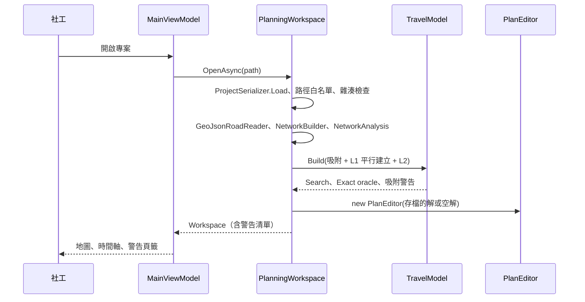
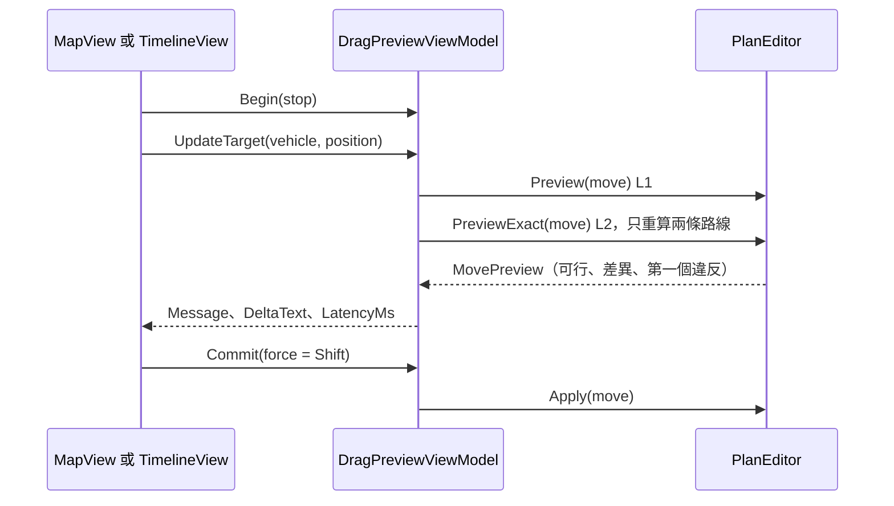

# 06 輸入輸出介面與資料流

本專案沒有 HTTP API，也沒有資料庫。對外介面是**檔案格式**與**命令列**，資料存在 JSON 專案檔中（這也是第 05 章略過的原因）。本章先列出所有輸入輸出格式，再用時序圖走四條核心流程。

## 1. 輸入格式

### 1.1 路網：GeoJSON

讀取器：`GeoJsonRoadReader.ReadFile()`（`src/MealRoute.Core/GeoJson/GeoJsonRoadReader.cs`）。

```json
{"type":"FeatureCollection","features":[
  {"type":"Feature",
   "properties":{"id":"h-0-0","class":"arterial","oneway":"yes"},
   "geometry":{"type":"LineString","coordinates":[[121.45,25.0],[121.451,25.0]]}}
]}
```

| 屬性 | 值 | 處理 |
|---|---|---|
| `id` | 字串 | 錯誤訊息與小分量警告會引用它；缺少時用 `#索引` |
| `class` | `arterial`、`collector`、`residential` | 缺少或未知 → 警告並視為 `residential`（📄 🔶 決策 5，使用者確認） |
| `oneway` | `true`／`"yes"` → 順向；`"-1"` → 逆向；其他 → 雙向 | 逆向時建一條 to→from 的邊 |
| geometry | 只接受 `LineString` | 其他類型（含 `MultiLineString`）列為錯誤並略過該筆 |

錯誤分兩級：

- **文件層級**（不是合法 JSON、根物件不是 `FeatureCollection`）→ 丟 `GeoJsonFormatException`，訊息含行號。
- **單筆 feature 問題**（座標不足、經緯度超出範圍、長度為 0）→ 收進 `ImportIssue` 清單，該筆略過，其他照常匯入。這是「不崩潰、逐筆回報」需求的實作方式。

### 1.2 名單與車輛：CSV

`RosterCsv`（`src/MealRoute.Core/Projects/RosterCsv.cs`）的欄位：

```
站點：id,name,lat,lon,address,note,meals,boxes,service_min,window_start,window_end,mandatory,priority
車輛：id,driver,start_lat,start_lon,end_lat,end_lon,earliest_start,latest_end,meal_capacity,box_capacity,max_work_hours
```

注意 CSV 用「分鐘」「小時」這類人類單位（`service_min`、`max_work_hours`），內部一律轉成秒。

### 1.3 Solomon 實例

`SolomonInstance.Load()`（`src/MealRoute.Core/Benchmark/SolomonInstance.cs`）讀標準 Solomon 文字格式，轉成 `ProblemInstance`，搭配 `EuclideanOracle`（靜態模式：行車時間＝歐氏距離，無休息、無工時上限）。

## 2. 持久化：專案檔（JSON）

`ProjectSerializer`（`src/MealRoute.Core/Projects/ProjectSerializer.cs`），目前 `schemaVersion` 為 1。節錄（`samples/small/project.mealroute.json` 的結構）：

```json
{
  "schemaVersion": 1,
  "name": "合成範例（small）",
  "network": { "path": "city.geojson", "sha256": "<路網檔的 SHA-256>" },
  "speedProfile": { "arterial": [60, 60, "...共 96 個"], "collector": ["..."], "residential": ["..."] },
  "breakRule": { "maxDrivingSeconds": 16200, "breakSeconds": 1800 },
  "stops": [
    { "id": "S001", "name": "<姓名>", "lat": 24.998, "lon": 121.470, "address": "<地址>", "note": "",
      "meals": 1, "boxes": 1, "serviceSeconds": 240,
      "windowStart": 39041.1, "windowEnd": 41741.1, "mandatory": true, "priority": 3 }
  ],
  "vehicles": [
    { "id": "V01", "driverName": "<駕駛>", "startLat": 25.014, "startLon": 121.466, "endLat": 25.014, "endLon": 121.466,
      "earliestStart": 36000, "latestEnd": 52200, "mealCapacity": 26, "boxCapacity": 10, "maxWorkSeconds": 16200 }
  ],
  "solution": { "routes": [ { "vehicle": "V01", "departure": 36500, "endArrival": 45000,
      "visits": [ { "stop": "S001", "arrival": 39100, "serviceStart": 39100, "departure": 39340, "breakAfter": false } ] } ],
    "unserved": [ { "stop": "S017", "reason": "..." } ] },
  "locks": { "routes": [], "stops": [ { "stop": "S001", "vehicle": "V01", "position": 0 } ] },
  "optimizer": { "seed": 11, "timeLimitSeconds": 60, "maxIterations": 20000, "runs": 4 }
}
```

設計重點：

| 做法 | 理由 |
|---|---|
| 檔案內用**站點 id／車輛 id** 互相參照，記憶體內用整數索引 | 檔案可讀、可手改；記憶體可查表 |
| 私有 DTO（`FileDto`、`StopDto`…）與領域 record 分開 | 檔案格式可以演進而不動到領域模型 |
| 數字以 round-trip 精度寫出，允許 `Infinity` | 存了再讀完全不失真（有測試） |
| 先寫 `.tmp` 再 `File.Move(..., overwrite: true)` | 「never leave a half-written project behind」（程式註解） |
| `schemaVersion` 大於支援版本 → 明確訊息 | 📄 `docs/01-system-analysis.md` §4.14 |
| 路網只存相對路徑＋SHA-256，不內嵌 | 路網可能數十 MB；雜湊不符時警告「檔案已被修改」 |
| 路網路徑走白名單（本機磁碟或專案資料夾內） | 防止開啟他人專案時自動連線網路路徑而洩漏憑證（見 11 章） |

時刻一律是「當天 0 點起算的秒數」：`36000` 是 10:00，`52200` 是 14:30。

## 3. 輸出格式

| 輸出 | 實作 | 特點 |
|---|---|---|
| 路線單 | `RouteSheetBuilder.Build()`（`src/MealRoute.Core/Reports/RouteSheet.cs`） | 每位駕駛一頁：站序、預計到達、時間窗、地址、備註、餐盒／保溫箱、休息標示；時刻來自 L2 精確排程 |
| 路線 CSV | `RouteCsv.Write()`（`src/MealRoute.Core/Reports/RouteCsv.cs`） | UTF-8 with BOM（讓 Excel 正確顯示中文）；同時有人看的欄位（`arrival` 為 `HH:mm`）與機器讀的欄位（`arrival_s` 為秒數 round-trip），所以可以再匯入 |
| 路線 GeoJSON | `RouteGeoJson.Write()`（`src/MealRoute.Core/Reports/RouteGeoJson.cs`） | 每條路線一個沿實際道路的 LineString，加上站點 Point；可再匯入 |

路線 CSV 的欄位：

```
vehicle_id,driver,seq,stop_id,stop_name,address,note,arrival,window,meals,boxes,break_after,
arrival_s,service_start_s,departure_s,route_departure_s,route_end_s,unserved_reason
```

文字欄（姓名、地址、備註）經過 `CsvText.Escape()`：以 `=`、`+`、`-`、`@` 等開頭的文字會加上前置單引號，避免 Excel 當成公式執行；匯入時 `CsvText.Unescape()` 去掉，所以往返無損。

## 4. 命令列介面

`tools/MealRoute.Cli/Program.cs`：

| 指令 | 參數 | 用途 |
|---|---|---|
| `generate` | `--size small\|medium\|large`、`--out <dir>`、`--seed <n>` | 產生合成城市（GeoJSON）與專案檔 |
| `solve` | `--project <file>`、`--seconds <n>`（預設 60）、`--iterations <n>`、`--runs <n>`、`--save` | 匯入、建快取、最佳化，印出指標與吸附警告（含站名） |
| `solomon` | `--dir`、`--only <prefix>`、`--seconds`、`--iterations`、`--runs`、`--seed`、`--out <file>` | Solomon 基準，輸出 Markdown 表格 |

結束代碼：0 成功；1 未知指令；2 參數、格式或檔案錯誤（訊息寫到 stderr）。

## 5. 核心流程的資料流

### 5.1 開啟專案到第一個可行解

這張圖看「一個專案檔變成可互動的排班」要經過哪些步驟，以及哪些在背景執行。



此時還沒有最佳化。按「開始最佳化」才進入 5.2；CLI 的 `solve` 則把兩者串在一起，並量測「匯入到第一個可行解」的時間。

### 5.2 最佳化

```mermaid
sequenceDiagram
  participant OVM as OptimizationViewModel
  participant OPT as Optimizer
  participant RUN as AlnsRun x4
  participant L1 as L1 Search oracle
  participant L2 as L2 Exact oracle
  OVM->>OPT: RunAsync(目前的解, 鎖定, 選項)
  OPT->>RUN: Construct（regret-2 建構）
  par 4 個獨立 run
    RUN->>L1: 大量 ArrivalTime 查詢
    RUN-->>OVM: 進度（經 IUiDispatcher）
  end
  OPT->>OPT: 依（目標值, run 編號）選最佳
  OPT->>L2: FinalizeExact：精確重算、修復、補插
  OPT-->>OVM: OptimizationResult
  OVM->>OVM: editor.ReplaceSolution（可復原）
```

### 5.3 拖曳預覽



### 5.4 當天重新排程

```mermaid
sequenceDiagram
  participant RVM as RescheduleViewModel
  participant RS as Rescheduler
  participant F as TravelModelFactory
  participant OPT as Optimizer
  RVM->>RS: Run(目前計畫, Now, 回報清單, 鎖定)
  RS->>RS: 分類每台車、改寫途中車輛
  RS->>F: 新的地點清單（回報位置是新地點）
  F-->>RS: 新的 Search、Exact oracle
  RS->>OPT: Run(子問題, canServe)
  OPT-->>RS: 子問題的解
  RS->>RS: 合併已完成站（原時刻）與重排部分
  RS-->>RVM: RescheduleResult（前後比較）
```

為什麼要重建行車時間模型？回報位置可能在路段中間，是原本沒有的地點，必須重新吸附並建立快取。`TravelModelFactory` 是委派（delegate），App 傳入「用路網建 L1/L2」的版本，靜態模式與測試傳入歐氏版本。
