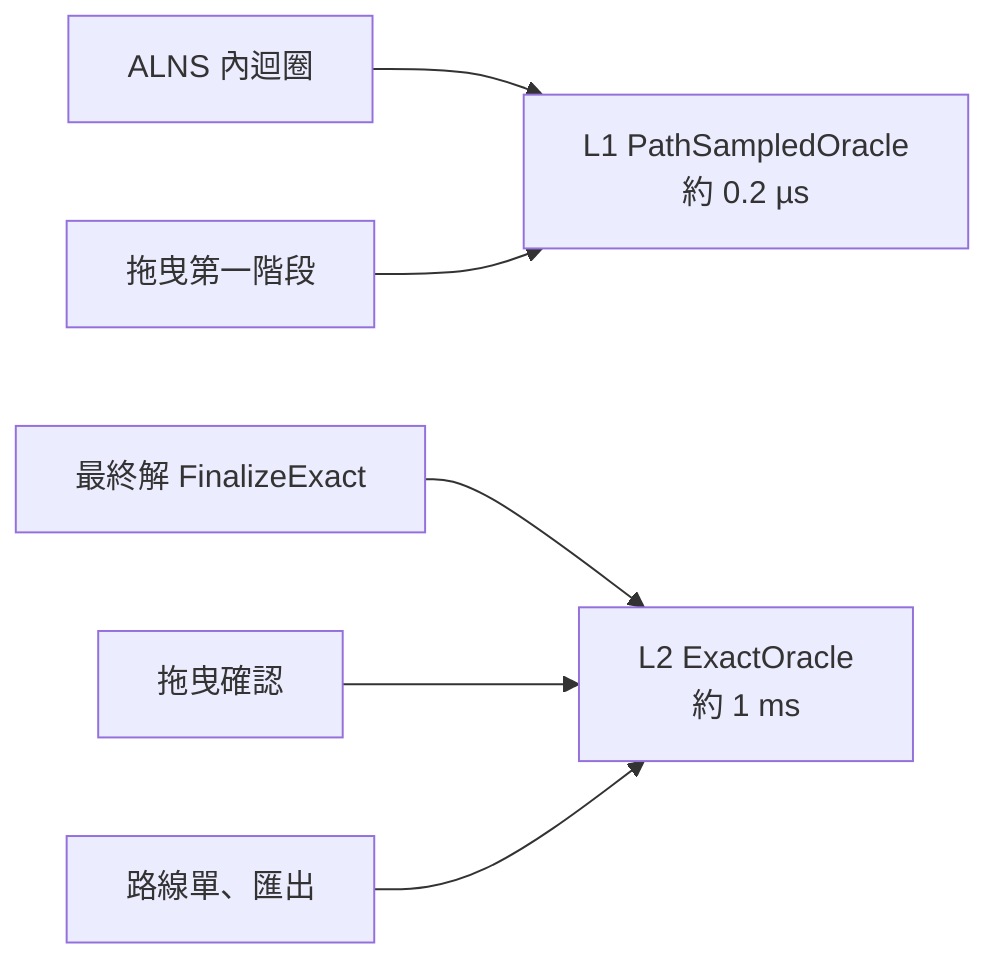
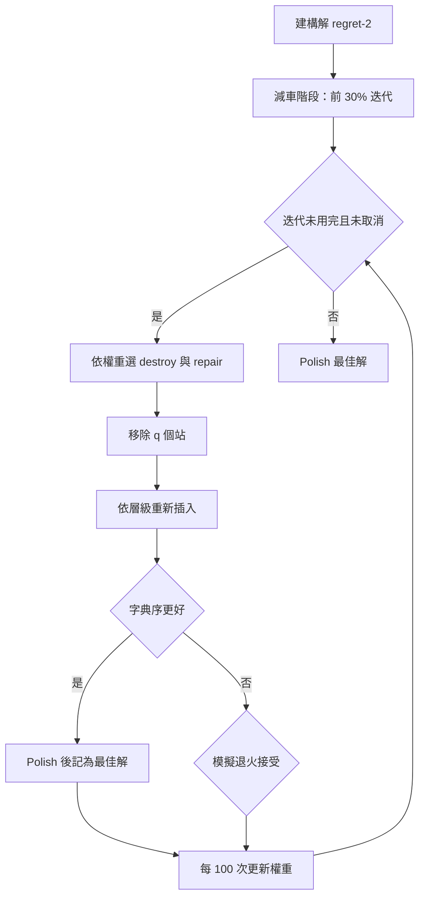
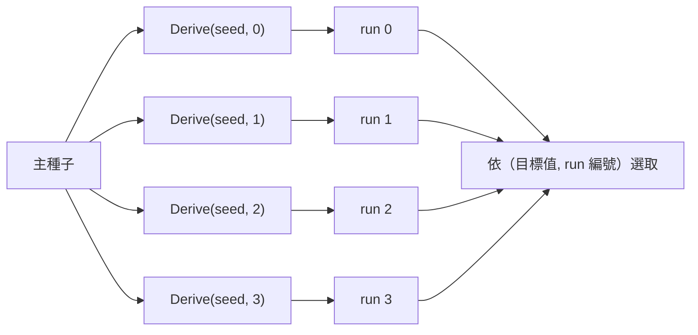

# 08 核心演算法

本專案的問題是**時間相依的帶時間窗車輛路徑問題**（Time-Dependent Vehicle Routing Problem with Time Windows, TD-VRPTW），再加上兩種容量、工時上限、駕駛休息、必送／選送與字典序目標。本章依「資料流的順序」拆解五個演算法：

1. 速度模型與 FIFO
2. 時間相依最短路徑
3. 行車時間快取（L1／L2）
4. 路線評估：出發時刻與休息
5. 最佳化：ALNS

---

## 1. 速度模型與 FIFO

### 問題

同一條 1 km 的路，11:00 進入與 11:50 進入（午餐尖峰 11:30 開始降速）所需時間不同。給定路段長度、道路等級與進入時刻，要算出離開時刻，而且必須保證「晚進入不會早離開」（FIFO, First-In-First-Out）。

### 輸入與輸出

- 輸入：道路等級、長度 L（公尺）、進入時刻 t（當天秒數）。
- 輸出：離開時刻。
- 參數：每個等級 96 個時段的速度（km/h），時段 k 涵蓋 [900k, 900(k+1)) 秒，一天後循環。

### 步驟

```
remaining = L
k = ⌊t / 900⌋
loop:
    v = speed[k mod 96]
    available = 900(k+1) − t          # 本時段剩下的秒數
    if v · available ≥ remaining:
        return t + remaining / v
    remaining −= v · available
    t = 900(k+1); k += 1
```

實作：`SpeedProfile.ArrivalTime()`（`src/MealRoute.Core/Travel/SpeedProfile.cs`）。

### 為什麼一定是 FIFO

兩台車在同一路段上，任何時刻都以相同速度前進（速度只看「現在幾點」和道路等級）。晚進入的車在任何時刻離終點都不會比早進入的車近，所以不可能先到。路徑的到達函數是各路段函數的合成，單調不減函數的合成仍單調不減，因此**任意路徑都是 FIFO**。📄 README「速度模型與 FIFO」。

對比一個**不是** FIFO 的常見錯誤模型：「用進入時刻的速度走完整條路」。11:29:59 進入的車以平常速度走完，11:30:00 進入的車以尖峰速度走完，前者可能比後者晚很多才出發卻更早到——這會讓最短路徑演算法失效。

### 複雜度與邊界

- 每次 O(跨越的時段數)，一般路段只跨 0–1 個時段。速度全天固定的等級直接 `t + L / v`（`_isConstant` 快速路徑）。
- 時段索引用整數 `k` 推進，而不是每次 `⌊t/900⌋`：浮點捨入讓 t 剛好落在邊界前一點點時，重算會得到同一個 k，迴圈可能停滯。📄 README：「以時段索引而非浮點比較決定速度，並處理浮點捨入落在邊界的情形，避免迴圈停滯」。
- 負的時段索引（理論上不會發生）也用 `Slot()` 正規化到 0–95。

### 替代做法

| 做法 | 比較 |
|---|---|
| 本專案：逐時段積分 | 精確、FIFO 有證明 |
| 進入時刻速度走完全程 | 簡單，但不是 FIFO |
| 分段線性旅行時間函數（PWL） | 可以做 profile search，但預處理與記憶體成本高（見第 3 節） |

---

## 2. 時間相依最短路徑

### 問題

給定起點與出發時刻，求到各節點的最早到達時刻（one-to-all），或到單一終點的最早到達（point-to-point）。

### 步驟

在 FIFO 下，以「到達時刻」為標籤的 Dijkstra（label-setting）就是精確解：一旦某節點被定案，之後不可能有更早到達的標籤，因為晚出發不會早到。邊的權重不再是常數，而是「進入時刻 → 離開時刻」的函數，鬆弛時呼叫 `SpeedProfile.ArrivalTime()`。

點對點查詢用 **A\***，啟發函數：

```
h(v) = haversine(v, target) / 全速度表的最高速度
```

直線距離不會長於任何路徑，以最高速度走直線所需時間不會多於實際，所以 h 是可容許（admissible）的。

實作：`TimeDependentDijkstra.Run()`（one-to-all，可多起點、可「目標全部定案就停」）、`TimeDependentDijkstra.EarliestArrival()`（A\*），`src/MealRoute.Core/Travel/TimeDependentDijkstra.cs`。

### 複雜度

O((V + E) log V)，2 萬節點的 one-to-all 約數毫秒。L2 隨機站對約 1 ms（📄 README「效能」）。

### 邊界

- 多起點初始標籤：重新排程時車輛位於路段中間，可以用「走完剩餘路段後的到達時刻」當作端點節點的初始標籤。
- 無法到達 → 回傳 `+∞`，評估器會回報「無法從路網抵達」。

---

## 3. 行車時間快取（L1／L2）

### 問題

這是本專案最關鍵的架構決策（📄 `docs/01-system-analysis.md` §4.6，🔶 決策 1，使用者於 2026-11-09 確認）：

- 最佳化每秒要做**數十萬次**站間行車時間查詢，每次只能花微秒。
- 規格要求「用於判定可行性的時間與以實際出發時刻精確計算相差 ≤ 1 秒，且不得違反 FIFO」。
- 一次 L2 查詢約 1 ms，直接用會慢上千倍；純粹在取樣時刻之間做線性內插，無法保證 1 秒誤差，也可能破壞 FIFO。

### 做法：取樣「路徑」而不是取樣「時間」

**L1 `PathSampledOracle`** 建置：

```
for 每個地點 i（站點與據點，大型範例 215 個）  [平行]
  for 每個取樣時刻 t_k（每 15 分鐘，涵蓋車輛時段，大型範例 39 個）
    one-to-all TD Dijkstra(i, t_k)，目標全部定案就停
    for 每個地點 j
      記下 i→j 的最佳路徑，壓縮成（等級, 長度）段
      若與已存的路徑相同就只記索引（去重）
```

**L1 查詢** τ(i, j, t)，t 落在 [t_k, t_{k+1}]：

```
取 t_k 與 t_{k+1} 兩個取樣點各自的最佳路徑
用實際出發時刻 t 沿路徑精確積分
回傳兩者較小的到達時刻
```

這個設計的巧妙之處在於它保留了三個性質（皆有性質測試）：

1. **上界**：值永遠是某條真實路徑的精確時間 → 不小於真正的最短時間；在取樣時刻等於精確值。
2. **FIFO**：每條路徑的到達函數都單調，取最小值仍單調；相鄰區間在共用的取樣點上都等於精確值，所以接縫連續 → 全域 FIFO。
3. 只有當區間內的最佳路徑「換成第三條」時才會高估。

**L2 `ExactOracle`**：以實際出發時刻跑點對點 TD A\*，依（起, 迄, 出發時刻）記憶。

**誰用哪一層**：



**為什麼最後用 L2 裁決是安全的**：L1 是上界，L1 判定可行的路線在 L2 下各站只會更早到，時間窗、最晚返回、工時都不會變差。唯一可能翻轉的是**休息規則**：行車時間變短，累計行車可能在不同位置越過 4.5 小時。所以 `Optimizer.FinalizeExact()` 先修復 L2 下不可行的路線，再嘗試把未服務的站補插回去（L2 比較快，可能放得下）。

### 複雜度與實測

- 建置：地點數 × 取樣數 次 one-to-all。大型範例 215 × 39 = 8,385 次，24 核心 3.03 秒（📄 README「效能」）。
- 記憶體：每對地點平均 1–3 條壓縮路徑，數 MB；整個大型範例流程峰值 141 MB。
- 查詢：O(兩條路徑的段數)，約 0.2 µs。

### 邊界

- 取樣範圍外的出發時刻：使用邊界取樣點的路徑（`Interval()` 夾到 [0, K−2]），性質不變，不會退回慢速計算。
- 未吸附的地點（節點為 −1）：查詢回傳 `+∞`。
- 同一節點：時間 0、距離 0（同座標的多個站共用同一個虛擬節點）。

### 替代做法

| 做法 | 為什麼沒選 |
|---|---|
| 只用 L2，不快取 | 每秒只能做數千次查詢，最佳化品質差（📄 設計文件「替代方案 a」） |
| 精確 profile search（分段線性到達函數） | 2 萬節點 × 200 站的預處理時間與記憶體不可控（📄 設計文件「替代方案 b」） |
| 取樣時刻之間線性內插 | 無法保證 1 秒誤差，也不保證 FIFO |
| Contraction Hierarchies 等加速技術 | 時間相依版本實作複雜度高；🔍 文件未提及 |

---

## 4. 路線評估：出發時刻與休息

### 問題

給定一台車和站序，決定：

- **何時從據點出發**（`Departure`）；
- **在哪一站服務後休息**（累計行車超過 4.5 小時之前，必須休息 30 分鐘）；
- 並判斷是否可行、算出行車與工時。

工時 = 回到據點時刻 − 出發時刻，**包含等待**。所以出發太早，在時間窗外空等的時間全部算進工時，可能讓一條其實可行的路線超過工時上限。

### 4.1 出發時刻：前向時間餘裕（forward time slack）

**具體例子**（取自測試 `Departure_is_delayed_to_absorb_mid_route_waiting_which_makes_a_tight_work_limit_feasible`）：

- 據點在 0，A 在 100（時間窗 0–5000），B 在 200（時間窗 5000–5100），速度 1 m/s，工時上限 1000 秒。
- 最早出發（0 秒）：100 秒到 A，200 秒到 B，**在 B 等 4800 秒**，回到據點 5200 秒，工時 5200 → 超過上限，判為不可行。
- 但若 4800 秒才出發：4900 到 A，5000 到 B 剛好開門，5200 回到據點，工時 400 → 可行。

**計算**：先以最早可出發時刻模擬一次，沿途累計：

```
waited = 到目前為止的總等待
slack  = min over 已經過的站 j ( 到 j 為止的累計等待 + 時間窗結束_j − 開始服務_j )
可延後量 delay = min(waited, slack)
```

例子中：A 的 slack = 0 + 5000 − 100 = 4900；B 的等待 4800，slack = 4800 + 5100 − 5000 = 4900；delay = min(4800, 4900) = 4800。

直覺：延後出發 δ 秒，每一站的到達都晚 δ 秒，但「等待」會先吸收這個延後。只要 δ 不超過「某站之前的累計等待 + 該站剩餘的時間窗空間」，就不會有任何站遲到；而且 δ 不超過總等待，回程時刻就不變。所以延後 delay 秒只會縮短工時，不會讓任何其他條件變差。

實作：`RouteEvaluator.Forward()` 計算 `waited`、`slack` 並輸出 `delay`；`RouteEvaluator.Settle()` 決定最終出發。

**時間相依時的修正**：行車時間會隨出發時刻改變，延後 delay 秒後各站的到達不一定剛好晚 delay 秒。`Settle()` 以定點迭代修正：

```
walk = Forward(最早出發)
repeat 最多 12 次，直到剩餘可吸收的等待 < 0.5 秒：
    later = Forward(walk.出發 + step)
    若 later 可行且工時較短：walk = later，step = later 的新 delay
                              若 later 比目前選定的更好，選它
    否則：step /= 2            # 時間相依讓某站關窗或回程變晚，改試較小的延後
另外再試「第一站不等待」的出發時刻
```

**候選的選擇順序**（2026-11-11 修正後）：

1. 符合工時上限的優先；
2. 行車時間較少（微秒格點）；
3. 工時較短。

為什麼行車在工時之前？因為目標的字典序就是「行車 → 工時」。第一版只要工時變短就接受延後，結果在時間相依路網上會把車延後到尖峰，大型範例 60 秒的總行車從 17:00 變成 18:12（見 11 章踩坑紀錄）。靜態行車時所有候選的行車都相同，所以這個順序不影響窮舉比對的結果。

### 4.2 休息位置

規則：累計行車（不含等待與服務）超過 4.5 小時之前，必須在某站服務後休息 30 分鐘，休息後重新累計。

**做法**（`RouteEvaluator.SearchBreaks()`）：

```
Recurse(起點, 時刻, 累計行車, ...):
  for 下一段行程 j：
    若 累計行車 + 這段 > 上限：
        for 每個可休息的站 k（上次休息之後、j 之前）：
            在 k 休息，從 k 之後遞迴
        return                       # 不休息不可能過關，只在這裡分支
    否則照常前進
  到達終點：比較（行車, 工時含可延後量, 返回時刻），保留最好的
```

只在「不休息就會超過上限」的位置分支，所以：

- 不需要休息的路線**不會被插入休息**（📄 需求明確要求）；
- 休息可以提前到某段等待之前，讓等待吸收休息時間（測試 `Break_is_placed_before_a_waiting_period_when_that_returns_earlier`）。

路線通常 ≤ 30 站、最多 1–2 次休息，分支數很少。結果與窮舉所有休息組合一致（性質測試 `Property_static_feasible_evaluations_are_optimal_in_travel_then_return_over_break_placements`）。

### 4.3 不可行時的診斷

`Simulate(..., diagnostic: true)` 把休息放在最晚可能的位置，遇到違反也繼續模擬，記錄**時間最早**的違反。這樣 UI 才能說出「王奶奶 12:10 到，時間窗 11:30–12:00」而不是只說「不可行」。

### 複雜度

- 不需休息：O(n) 次 oracle 查詢，再乘上 `Settle()` 的迭代次數（靜態約 1–2 次，時間相依最多十幾次）。
- 需要休息：O(n^b)，b 為休息次數，實務上 b ≤ 2。

### 替代做法

| 做法 | 比較 |
|---|---|
| 本專案：前向時間餘裕 + 定點迭代 | 靜態時精確；時間相依時是近似，但不會接受讓排程變差的一步 |
| 一律最早出發 | 簡單，但中段等待會被算進工時，誤判可行路線（這就是審查報告指出的 bug） |
| 只消除第一站等待（原設計 🔶 決策 3） | 處理不了午餐與晚餐之間的中段等待 |
| 參考實作的反向「最晚開始」 | 從最早返回時刻往回推每站最晚可開始服務的時刻；`tests/MealRoute.Tests/Reference/RefExhaustiveSolver.cs` 刻意用這個不同的演算法，交叉驗證語意 |

---

## 5. 最佳化：ALNS

### 問題

在所有路線都可行的前提下，最小化字典序目標：**未服務必送站數 → 未服務選送優先權總和 → 使用車輛數 → 總行車 → 總工時**。

### 整體流程



實作：`AlnsRun.Run()`、`AlnsRun.Search()`（`src/MealRoute.Core/Optimization/AlnsRun.cs`）。

### 運算子

| 類型 | 運算子 | 說明 |
|---|---|---|
| destroy | 隨機 | 隨機移除 q 個站 |
| destroy | 最差 | 依「移除後節省的行車」排序，以 `rand^3` 偏向挑節省多的 |
| destroy | 相關（Shaw） | 從一個種子站開始，依「行車時間＋時間窗開始時刻差」的相關度，以 `rand^6` 偏向挑相近的 |
| destroy | 整條路線 | 移除一整條路線的可變部分 |
| repair | greedy | 每次插入成本最低的站 |
| repair | greedy＋雜訊 | 成本乘上 ±15% 雜訊 |
| repair | regret-2、regret-3 | 優先插入「現在不插、之後會損失最多」的站 |
| repair | 隨機順序 | 同層級內隨機順序插入，並以 10% 機率略過某位置（SISR 式 blink） |

移除數量 q ∈ [max(1, min(4, n/10)), min(60, 0.4n)]；站數 ≤ 12 時允許全部重建。

### 權重與接受

- 每 100 次迭代依成績更新權重：新最佳 33 分、被接受且較好 9 分、被接受但較差 13 分，反應係數 0.1，下限 0.05。
- 模擬退火：起始溫度 `0.05 × max(行車, 600) / ln 2`，結束溫度為起始的 1/1000，等比冷卻。接受與否比較的是**純量**（第 07 章 7.2 節），最佳解比較的是**精確字典序**。

### 減車階段

前 30% 的迭代（`VehicleReductionShare`）嘗試清空站數最少的路線：移除它的所有站，把可用車輛限制為「目前有站的車」，搜尋一段時間。成功就接受並繼續清空下一條；失敗就停止，進入一般搜尋。

### 局部改善（Polish）

新最佳解出現時（站數 ≤ 80）與結束時執行：

1. 路線內 relocate 與 2-opt（first improvement）；
2. 路線間的「顆粒化」relocate／swap：每站只看 12 個最相關的鄰居（granular neighbourhood），把 O(n²) 的配對縮小到 O(12n）；
3. 2026-11-11 加入的**必送站交換**：有必送站沒排上時，嘗試「移除一個相關的已服務必送站 → 插入未服務的必送站 → 依優先權把選送站填回」，只要精確目標變好就套用。

### 決定性與平行



- run 的數量固定（預設 4），與 CPU 核心數無關；每個 run 有自己的亂數流，由主種子以 SplitMix64 衍生。
- 結果依 run 編號寫入陣列，最後以（目標值, run 編號）選出，所以 1、3、4 個執行緒的結果完全相同（測試 `Same_seed_and_iteration_limit_give_identical_results_regardless_of_thread_count`）。
- 以**迭代上限**結束才可重現；**時間上限**只是安全停止，結果會隨機器速度而異。

### 品質實測

- 與窮舉最佳解比對：三組情境 200/200、120/120、150/150 組完全相同（測試門檻為 95%）。
- Solomon 29 個實例：29/29 在 BKS + 1 車、105% 距離以內，15 個等於 BKS（180 秒）。

### 替代做法

| 做法 | 比較 |
|---|---|
| 本專案：ALNS（Ropke & Pisinger 式） | 運算子容易擴充（必送站交換就是後來加的），對各種限制都只需要「評估器說可不可行」 |
| 混合整數規劃（MIP） | 200 站、時間相依、休息規則下求解時間不可控 |
| 禁忌搜尋、遺傳演算法（如 HGS） | HGS 在標準 VRPTW 上更強，但實作複雜度高；🔍 文件未記載為何選 ALNS |
| 現成求解器（OR-Tools） | 專案原則不使用現成最佳化套件（見 04 章） |
