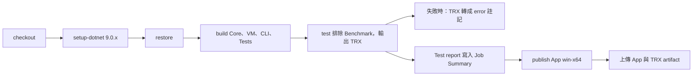

# 10 建置、發佈與環境設定

## 1. 環境需求

| 項目 | 需求 | 來源 |
|---|---|---|
| 作業系統 | Windows 10 1809 以上（x64） | 📄 README「建置與執行」 |
| SDK | .NET 9 SDK（`global.json`：9.0.100 起，`latestFeature` 前滾） | `global.json` |
| IDE | 不需要 Visual Studio | 📄 README |
| 資料庫、外部服務 | 無 | — |

只建置與測試 Core、ViewModels、CLI 的話，理論上任何能跑 .NET 9 的平台都可以；🔍 但 `MealRoute.sln` 包含 WinUI 專案，在非 Windows 上請個別建置專案。

## 2. 本機啟動步驟

```powershell
git clone https://github.com/hn83320589/MealRoute.git
cd MealRoute

# 建置整個方案（App 需要指定 Platform）
dotnet build MealRoute.sln -c Release -p:Platform=x64

# 測試（與 CI 相同）
dotnet test tests/MealRoute.Tests -c Release --filter "Category!=Benchmark"

# 發佈並執行桌面 App，可直接帶入專案檔路徑
dotnet publish src/MealRoute.App -c Release -r win-x64 -p:Platform=x64 -o publish/win-x64
publish/win-x64/MealRoute.App.exe samples/medium/project.mealroute.json
```

命令列工具：

```powershell
dotnet run --project tools/MealRoute.Cli -c Release -- generate --size large --out samples/large
dotnet run --project tools/MealRoute.Cli -c Release -- solve --project samples/large/project.mealroute.json --seconds 60
dotnet run --project tools/MealRoute.Cli -c Release -- solomon --seconds 180 --out benchmarks/solomon/RESULTS.md
```

## 3. 設定項與檔案位置

本專案沒有環境變數、連線字串或密鑰。

| 名稱 | 位置 | 用途 | 必填 |
|---|---|---|---|
| 專案檔 | 預設 `%UserProfile%\Documents\MealRoute\` | 路網參照、名單、車輛、解、鎖定、最佳化設定 | 使用 App 時必要 |
| 設定檔 settings.json | `%LocalAppData%\MealRoute\` | `LastProjectPath`、`OptimizerSeconds`（預設 60）、`OptimizerRuns`（預設 4） | 否，讀不到就用預設值 |
| 當機記錄 `crash.log` | `%LocalAppData%\MealRoute\` | 未預期的 UI 例外 | 自動產生 |

專案檔內的最佳化設定（`optimizer` 區段）：

| 欄位 | 範例值 | 說明 |
|---|---|---|
| `seed` | `1` | 主種子 |
| `timeLimitSeconds` | `60` | 時間上限（安全停止，結果隨機器而異） |
| `maxIterations` | `20000` | 每個 run 的迭代上限（要完全重現請以此結束） |
| `runs` | `4` | 獨立搜尋次數（與執行緒數無關） |

## 4. 部署形式

App 以 **unpackaged、自含** 方式發佈（`src/MealRoute.App/MealRoute.App.csproj`）：

- `WindowsPackageType=None`：不打包 MSIX，直接執行 exe。
- `WindowsAppSDKSelfContained=true`、`SelfContained=true`：Windows App SDK 與 .NET 執行階段都包在發佈資料夾內，使用者不需另外安裝。

把 `publish/win-x64` 整個資料夾複製到目標電腦即可執行。

## 5. CI（GitHub Actions）

`.github/workflows/ci.yml`，在 push 到 main、pull request、手動觸發時執行，跑在 `windows-latest`。



| 步驟 | 重點 |
|---|---|
| Build | 個別建置四個非 App 專案（`--no-restore`），App 在 publish 步驟才建置 |
| Test | `--logger "trx;LogFileName=results.trx"`，結果放在 runner 上的 TestResults 資料夾 |
| Report failed tests as annotations | 只在失敗時執行；用 PowerShell 解析 TRX，把每個失敗測試轉成 `::error title=...::訊息`，在執行頁面直接看到原因，不必下載 log |
| Test report (job summary) | 一律執行（`if: always()`）；把總數、耗時、各測試類別通過／失敗數、失敗清單寫入 `$GITHUB_STEP_SUMMARY` |
| Publish | `dotnet publish src/MealRoute.App -c Release -r win-x64 -p:Platform=x64` |
| Artifacts | `MealRoute-win-x64`（可直接下載執行）、`test-results`（TRX） |

CI 頁面：<https://github.com/hn83320589/MealRoute/actions/workflows/ci.yml>。

## 6. 常見問題

| 症狀 | 原因與排除 | 來源 |
|---|---|---|
| CI 上端對端測試失敗，本機正常；錯誤是路網雜湊不符 | `.gitattributes` 的 `* text=auto` 讓 Windows runner 以 CRLF 簽出 `city.geojson`，SHA-256 改變。已設定 `*.geojson -text`、`samples/** -text`、`benchmarks/** -text`。新增資料檔時請確認它們不會被換行轉換 | 📄 commit `3771ba5` |
| 建置失敗，訊息是分析器警告 | `TreatWarningsAsErrors=true`，任何警告都是錯誤。修正警告；確實不適用時在該專案的 `NoWarn` 加上規則並註明原因 | `Directory.Build.props` |
| 開啟專案時出現「網路或裝置路徑，基於安全不會自動開啟」 | 專案檔參照的路網不在本機磁碟或專案資料夾內。確認來源可信後，用「匯入路網」手動選擇檔案 | 📄 commit `a5bd6b8` |
| 出現「路網檔內容與專案記錄的不同」 | 路網檔在存檔後被修改過（或換行被轉換）。結果可能與存檔時不同 | `PlanningWorkspace.OpenAsync()` |
| 列印對話框打不開 | WinUI 3 unpackaged 的列印限制；改用路線 CSV 或 GeoJSON 匯出 | 📄 README「已知限制」 |

建置整個方案時請照 README 加上 `-p:Platform=x64`：App 專案的 `Platforms` 只有 x64 與 ARM64。🔍 不加時可能出現的錯誤沒有實際紀錄。
